# BOPTEST Smart Building Digital Twin

**BOPTEST-Focused Technical Report — Team Review Draft**

Khalifa University · College of Engineering and Physical Sciences

Senior Design Project I · Fall 2026

22 November 2026

# Abstract

This BOPTEST-focused technical report documents the pinned BOPTEST Building Simulator (BESTEST Air 0.9.0), BOPTEST Forecast Model (O25 Random Forest), HVAC Action-Response Model (StepModel), HVAC Optimizer and Rolling HVAC Controller (partial five-minute receding-horizon control). The Live Digital Twin Dashboard shows the transition from observed state to forecast, candidate evaluation, command, verified readback and recovery. The genuine rolling session delivered 41 five-minute advances and measured 2.716347 kWh. Its single-arm design establishes operation in the simulator. In G218 Stage 1, measured electricity fell by 0.074920 kWh and the frozen project comfort criterion failed. G163 predictive fixed hold saved 0.3342% against native and failed the frozen project comfort gate. The G258 joint trial saved 0.2272% and failed the no-added-official-discomfort gate. This report preserves the engineering equations, model scores, experimental evidence and limitations for the BOPTEST stream of the SDP. Its evidence concerns one simulated zone under the benchmark conditions.

# Table of Contents

- [Chapter 1 Introduction](#chapter-1-introduction)
- [Chapter 2 System Overview](#chapter-2-system-overview)
- [Chapter 3 Theoretical Foundations and Engineering Model](#chapter-3-theoretical-foundations-and-engineering-model)
- [Chapter 4 Concept Generation and Design Evaluation](#chapter-4-concept-generation-and-design-evaluation)
- [Chapter 5 Implementation and Fabrication](#chapter-5-implementation-and-fabrication)
- [Chapter 6 Conclusions](#chapter-6-conclusions)
- [References](#references)
- [Appendix A Handbook Scope and Review](#appendix-a-handbook-scope-and-review)
- [Appendix B Source Code and Implementation References](#appendix-b-source-code-and-implementation-references)
- [Appendix C BOPTEST Forecast Model Full Evaluation](#appendix-c-boptest-forecast-model-full-evaluation)
- [Appendix D Derivations and Unit Checks](#appendix-d-derivations-and-unit-checks)
- [Appendix E Retained Numbering and Review Metadata](#appendix-e-retained-numbering-and-review-metadata)

# Chapter 1 Introduction

## 1.1 Goals and Scope

The project tests whether a controller can learn from measured simulator feedback and reduce cooling-plus-fan electricity while meeting prospectively frozen temperature constraints. The earlier simple simulator used an AC electricity channel. BOPTEST measures cooling and fan electrical power separately. The combined energy is the two integrated channels and has a benchmark-specific equipment boundary. We adopted BOPTEST to compare policies in a repeatable plant with known weather, native control, checked commands and standardized KPI definitions. This report follows the SDPI handbook chapter order for the BOPTEST stream. The wider proposal and formal approvals are separate team and course records. [SRC-001](../SDP_BOPTEST_Pilot/client.py) [SRC-004](../SDP_BOPTEST_Pilot/deployment/official_v0.9.0/project1-boptest-0.9.0/testcases/bestest_air/models/BESTESTAir/BaseClasses/FanCoilUnit_T.mo) [DATA-001](../SDP_BOPTEST_Pilot/deployment/official_v0.9.0/project1-boptest-0.9.0/testcases/bestest_air/models/wrapped.fmu).

## 1.2 Engineering Questions

| Question | Evidence | What it establishes |
| --- | --- | --- |
| Can the application observe, predict and verify an action? | Genuine 41-advance rolling session | Verified simulated integration |
| Does a candidate reduce energy over intervention plus recovery? | Matched native and treatment traces | Benchmark effect over the selected clock |
| Does the saved energy meet comfort acceptance? | Frozen official and project KPIs | Campaign-specific verdict |
| Can the optimizer choose economic early release? | Prepared same-state branch | Open empirical question |

**Table A. Engineering questions and evidence boundaries.** [EXP-002](../SDP_BOPTEST_Pilot/autonomous_hvac_stage1/g218_runtime_state/batches/G218_STAGE1_NATIVE_AUTONOMOUS/PAIRED_VALIDATION.json) [EXP-005](../SDP_BOPTEST_Pilot/final_energy_control/live_twin_evidence/LIVE_ROLLING_TWIN_01/batches/LIVE_ROLLING_TWIN_01/LIVE_CONFIGURATION.json) [EXP-008](../SDP_BOPTEST_Pilot/final_energy_control/fan_trial_evidence/G258_JOINT060_1400_01/batches/G258_JOINT060_1400_01/JOINT_COMPARISON.json) [EXP-009](../SDP_BOPTEST_Pilot/final_energy_control/release_branch.py).

# Chapter 2 System Overview

## 2.1 Supported Modes

Native HVAC Control uses the unmodified BOPTEST schedules. Warmer Setpoint Control is the qualified 24.5°C cooling override with native heating. The HVAC Optimizer ranks supported modes, while the Rolling HVAC Controller owns the five-minute feedback contract. The Live Digital Twin Dashboard can serve a genuine authorized session or an existing recording. The separate G163 page compares three sealed trajectories. The Fan Control Experiment and the Joint HVAC Control Experiment are measured studies outside the current optimizer. [SRC-016](../SDP_BOPTEST_Pilot/final_energy_control/rolling_control.py) [SRC-017](../SDP_BOPTEST_Pilot/final_energy_control/digital_twin.py) [SRC-019](../SDP_BOPTEST_Pilot/stage4e_d0/plan.py) [SRC-024](../SDP_BOPTEST_Pilot/final_energy_control/live_dashboard.py) [EXP-003](../SDP_BOPTEST_Pilot/final_energy_control/optimizer_runtime_state/batches/OPTIMIZER_G163_NATIVE_FIXED_PREDICTIVE/OPTIMIZER_COMPARISON.json) [EXP-005](../SDP_BOPTEST_Pilot/final_energy_control/live_twin_evidence/LIVE_ROLLING_TWIN_01/batches/LIVE_ROLLING_TWIN_01/LIVE_CONFIGURATION.json) [EXP-006](../SDP_BOPTEST_Pilot/final_energy_control/fan_trial_evidence/G218_FAN060_1400_01/batches/G218_FAN060_1400_01/FAN_COMPARISON.json) [EXP-008](../SDP_BOPTEST_Pilot/final_energy_control/fan_trial_evidence/G258_JOINT060_1400_01/batches/G258_JOINT060_1400_01/JOINT_COMPARISON.json).

## 2.2 Data and Control Contract

| Layer | Input and clock | Output and evidence |
| --- | --- | --- |
| BOPTEST Building Simulator | Native warmup, benchmark forcing, five-minute advance | Verified endpoints and independent 30-second history |
| BOPTEST Forecast Model | Causal prefix and issued boundary | Observational forecasts with support status |
| HVAC Action-Response Model | Current verified state and supported action path | Candidate temperature and electricity trajectories |
| Rolling HVAC Controller | Feasibility, guard state and confirmed command feedback | One command, verified applied value, release/recovery state |
| Live Digital Twin Dashboard | Ordered recorded/live state | Forecast, prediction, measurement and comfort panels |

**Table B. BOPTEST interface contracts.** [SRC-003](../SDP_BOPTEST_Pilot/stage4e_d2i_1/transport.py) [SRC-011](../ml_research_v1_0_0/inference.py) [SRC-014](../SDP_BOPTEST_Pilot/final_energy_control/rolling_model.py) [SRC-017](../SDP_BOPTEST_Pilot/final_energy_control/digital_twin.py) [SRC-025](../SDP_BOPTEST_Pilot/final_energy_control/dashboard.html).

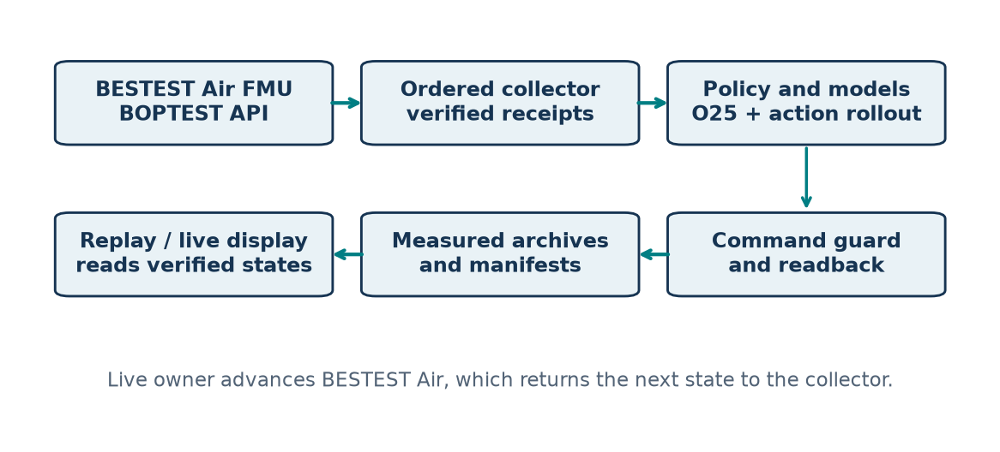
**Figure 1. BOPTEST observation, decision, readback and display.** Illustrative diagram based on the verified application. [SRC-017](../SDP_BOPTEST_Pilot/final_energy_control/digital_twin.py) [SRC-023](../SDP_BOPTEST_Pilot/dashboard.py) [SRC-024](../SDP_BOPTEST_Pilot/final_energy_control/live_dashboard.py). [FIG-001](../references/FIGURE_INDEX.md#fig-001)

# Chapter 3 Theoretical Foundations and Engineering Model

## 3.2.2 BOPTEST Building Simulator Geometry and Forcing

Implementation and evidence [SRC-004](../SDP_BOPTEST_Pilot/deployment/official_v0.9.0/project1-boptest-0.9.0/testcases/bestest_air/models/BESTESTAir/BaseClasses/FanCoilUnit_T.mo) [DATA-001](../SDP_BOPTEST_Pilot/deployment/official_v0.9.0/project1-boptest-0.9.0/testcases/bestest_air/models/wrapped.fmu).

The pinned test case is the high-mass BESTEST Case 900 room, with a 6 × 8 m footprint and 2.7 m height. The floor area is 48 m² and air volume is approximately 129.6 m³. The envelope includes a concrete slab, block/insulated exterior walls, an insulated framed roof, and two 3 × 2 m south windows, for a total glazed area of 12 m². Wall conduction, thermal storage and radiative exchange extend beyond the one-capacitance model. The case documentation specifies 0.5 air changes per hour for infiltration. On this area/height basis that is about 64.8 m³/h. With a representative density of 1.2 kg/m³, the implied mass flow is about 0.0216 kg/s. At a 10 K temperature difference the illustrative sensible exchange is around 0.217 kW, using cₚ ≈ 1.006 kJ/(kg·K). This is a scale calculation, while the test case uses its own fluid and heat transfer components. [5]–[7], [16],.

The embedded DRYCOLD Denver-Stapleton typical meteorological year supplies dry bulb, solar geometry and radiation and other boundary variables. BOPTEST's forecast endpoint returns a benchmark forecast vintage with a declared time grid. The data can align with deterministic future inputs from the simulator when issued. A real weather forecast would have error and delivery constraints. Scenario diversity therefore means different blocks of the same TMY and building. It does not imply multiple climates, sensor grids or floor plans.

The documented office has a maximum of two people and uses regular internal gain schedules. People, light and plug loads affect sensible and latent energy entering the zone. The wrapped model exposes signals such as lighting and plugs for observation. Those channels cannot be used as substitute occupancy measurements in an unrelated building. The selected FMU has no qualified lighting actuator or indoor illuminance output. Command options are determined by the wrapper and the campaign safety contract, not by the ability to edit Modelica source offline. [16],.

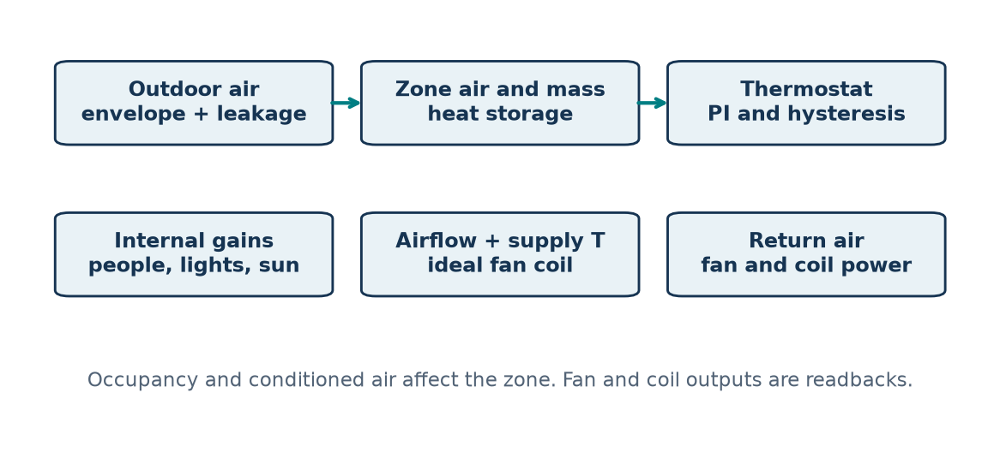
**Figure 2. Physical pathways inside the single-zone benchmark.** Illustrative diagram derived from the geometry and the fan-coil/thermostat source; [16]). The reduced diagram shows where heat can enter and where control changes the delivered air conditions. [FIG-002](../references/FIGURE_INDEX.md#fig-002)

## 3.2.3 Fan Coil and Electrical Boundaries

Implementation and evidence [SRC-004](../SDP_BOPTEST_Pilot/deployment/official_v0.9.0/project1-boptest-0.9.0/testcases/bestest_air/models/BESTESTAir/BaseClasses/FanCoilUnit_T.mo) [SRC-030](../SDP_BOPTEST_Pilot/final_energy_control/joint_fan_trial.py) [EXP-008](../SDP_BOPTEST_Pilot/final_energy_control/fan_trial_evidence/G258_JOINT060_1400_01/batches/G258_JOINT060_1400_01/JOINT_COMPARISON.json).

The idealized four-pipe fan coil circulates return air through a prescribed-temperature coil. Its air mass flow command is a dimensionless fraction multiplied by the 0.55 kg/s design flow. The fan component reports electrical power, while the coil operates with a prescribed supply-temperature source. The coil model assigns electrical or gas-equivalent input from the actual enthalpy change. From `FanCoilUnit_T.mo`, with h in J/kg and positive flow ṁ in kg/s:

**(2) Qcool = max(0, −ṁ × (hsupply − hreturn)).**

**(3) Qheat = max(0, ṁ × (hsupply − hreturn)).**

**(4) Pcool,electric = Qcool / 3.0, Pheat,gas = Qheat / 0.90.**

Cooling and fan are integrated as electricity. The heating channel is boiler fuel-input equivalent for the benchmark. It must not be added to an electrical total. If the target is thermal heating power, convert the gas-input channel with the verified 0.9 efficiency. With 0.33 kg/s and an 8 kJ/kg enthalpy drop, the model relationship yields 2.64 kW cooling and 0.88 kW electric cooling before fan. A fan reading of 40 W gives 0.92 kW combined and, if flat over 5 min, 0.0767 kWh.

The test case uses a flow-controlled fan with a nominal resistance/pressure specification of 185 Pa. `fan.P` is the reported electrical quantity. A fan affinity approximation suggests an electrical power ratio close to the cube of the flow ratio in some operating regimes. That is a screening approximation. We use actual model readbacks and measured fan W in experimental totals. Even when a lower flow saves fan electricity, the coil response can require a larger temperature difference and a recovery rebound. A constant COP means the simulation does not capture compressor or chiller efficiency variation with lift, coil temperature, part load, cycling limits or a real plant performance map. These limitations matter when savings are only a few Wh.

At 14:00 in the G258 joint experiment, the measured native airflow was 0.364863 kg/s, room air was 24.00443°C and effective native supply was 16.03903°C. The new flow target was 0.60 × 0.55 = 0.330 kg/s. Treating moist-air enthalpy change as cₚΔT and matching the initial sensible rate gives:

**(5) Tsupply,new = Troom − (ṁnative/ṁnew) × (Troom − Tsupply,native).**

The measured inputs give 15.19751°C or 288.34751 K. This command stayed fixed for 30 minutes. The equation matches an initial sensible proxy. Subsequent occupancy, envelope heat and native feedback can change the required rate. The applied supply readback comes from the effective override channel. It is not an independently instrumented supply sensor.

Equations (2)–(4) describe the pinned Modelica channels. Equation (5) is the implemented one-time control-candidate calculation using a sensible heat approximation. Energy totals use actual measured BOPTEST meters.

## 3.2.4 Thermostat, Override and Timing

Implementation and evidence [SRC-003](../SDP_BOPTEST_Pilot/stage4e_d2i_1/transport.py) [SRC-018](../SDP_BOPTEST_Pilot/autonomous_hvac_stage1/controller.py) [SRC-019](../SDP_BOPTEST_Pilot/stage4e_d0/plan.py) [SRC-021](../SDP_BOPTEST_Pilot/deployment/official_v0.9.0/project1-boptest-0.9.0/kpis/kpi_calculator.py) [EXP-002](../SDP_BOPTEST_Pilot/autonomous_hvac_stage1/g218_runtime_state/batches/G218_STAGE1_NATIVE_AUTONOMOUS/PAIRED_VALIDATION.json).

Native heating/cooling targets are 21/24°C in the occupied thermostat regime and 15/30°C outside it. The native thermostat changes to the unoccupied regime at 18:00. PI regulation and switching hysteresis control heating, cooling and fan operation. The model's room-temperature dead band does not imply that both powers immediately become zero because the system has prior state and dynamics. The intended safe fallback sends canonical zero activation flags and verifies native control has resumed. While actively overriding cooling, the collector checks the exact effective value separately from the requested value. Heating stays native.

The official benchmark comfort schedule is a distinct FMU resource. It remains occupied through 18:10 in the tested trace even though the thermostat releases at 18:00. The source audit reproduced the timing from the FMU resources and runtime readings. Therefore a short late-day excursion may be counted after the thermostat relaxes. For G218 both arms exceeded the project upper limit on the same five occupied minutes. The treatment's slightly higher temperature in those minutes increased degree-hours. The evidence bounds the difference to the event window and does not isolate a physical path from the morning actuation through the evening.

The scoring window begins after a seven-day native warmup, using independent initialization of each campaign arm. This establishes a common settled history and explicit start clock. The external control step is 300 s. The native history provides a 30 s grid, so one closed five-minute window contains 11 sample instants and ten trapezoids. Consecutive windows share the boundary sample. The command is effective for the following interval and the collector verifies the activation and effective targets at the next endpoint. The scheduler handles source-supported discontinuities explicitly. Requiring new setpoints at every exact boundary before checking the historian can incorrectly reject older published references. The initial D1 failure and the later D1 v2 repair are preserved as distinct records.

## 3.2.5 Energy, Peak and Discomfort

Implementation and evidence [SRC-020](../SDP_BOPTEST_Pilot/core.py) [SRC-021](../SDP_BOPTEST_Pilot/deployment/official_v0.9.0/project1-boptest-0.9.0/kpis/kpi_calculator.py) [SRC-022](../SDP_BOPTEST_Pilot/autonomous_hvac_stage1/evaluation.py) [EXP-002](../SDP_BOPTEST_Pilot/autonomous_hvac_stage1/g218_runtime_state/batches/G218_STAGE1_NATIVE_AUTONOMOUS/PAIRED_VALIDATION.json).

For uniformly or non-uniformly spaced verified samples, the scoring code sums a time-weighted area rather than treating an endpoint sample as interval power. With P measured in W and times in seconds:

**(6) E [kWh] = Σᵢ {(Pᵢ + Pᵢ₊₁)/2} × (tᵢ₊₁ − tᵢ) / 3,600,000.**

The electricity boundary uses P = Pcool + Pfan. For a single 30 s interval with 600 W at the start and 720 W at the end, the area is 19,800 J or 0.0055 kWh. At constant power 660 W throughout a five-minute block, its label is 0.660 kW and its energy is 0.055 kWh. An endpoint maximum in W answers a different question from a rolling average or an interval maximum. Peak demand claims must specify the sampling and boundary. No peak tariff policy was optimized in the final campaigns.

Let lower and upper comfort bounds be L(t), U(t). The degree-hour replay integrates the two nonnegative deviations:

**(7) D [K·h] = ∫ {max[0, L(t) − T(t)] + max[0, T(t) − U(t)]} dt, with t in hours.**

Under the project replay, use the same occupied timing as the benchmark, apply 20 and 26°C during occupied periods, and retain the native bounds during unoccupied periods. The separate occupied violation duration is computed only for occupied time outside the project band. Hold a deviation at 0.15 K for 10 min and it contributes 0.025 K·h. A few hundredths of a kelvin accumulated over short segments can change this KPI even when both arms have identical violation minutes. The official API final KPI and verified official-schedule prefix replay are shown separately. G218 near 18:00 illustrates why agreement on duration cannot replace a test of severity.

Define savings for a shared evaluation interval by `E_native − E_controlled`. The percentage is 100 times the savings divided by the same native energy. A positive recovery penalty is `E_controlled,recovery − E_native,recovery`. If a warming policy saves 0.10 kWh during the hold and costs 0.06 kWh during recovery, the net through recovery is 0.04 kWh. Full-window savings can differ when baseline and treatment continue along different thermal states after the recovery marker.

The scorer invokes trapezoidal integration for timed power and clipped temperature deviations. The original API value and project-band replay appear as separate outputs.

## 3.2.6 Forecast Scores and Models

Implementation and evidence [SRC-006](../ml_research_v1_0_0/dataset.py) [SRC-011](../ml_research_v1_0_0/inference.py) [DATA-004](../references/MODELS_AND_DATA.md#data-004).

For n same-origin errors eᵢ = ŷᵢ − yᵢ, the project uses:

**(8) MAE = Σ|eᵢ|/n, RMSE = √(Σeᵢ²/n), bias = Σeᵢ/n.**

Errors of −0.10, +0.05 and +0.30 K give MAE = 0.150 K, RMSE = 0.185 K and bias = +0.083 K. A few errors around a switch can disproportionately raise RMSE. MAE may remain small if stable periods dominate. We also examine regime-specific error, group-macro error, skill relative to persistence, and availability. Group-macro MAE averages the mean error of each held scenario group equally, while the pooled measurement weights each origin equally. These values differ when one held group has many more usable observations. A model that refuses hard cases can appear accurate in the remaining cohort, so coverage is part of the result.

Persistence is an essential comparator. It predicts the last valid indoor value and recent average power. A well-regulated room often moves slowly over 5 minutes, particularly under steady load. Forests can model interactions and longer leads yet show worse error than persistence on a short quiet slice. OLS estimates coefficients by minimizing squared error. Ridge adds λ‖β‖² to suppress large coefficients in correlated feature sets. In the BOPTEST study, training-only scaling and inner group splits determine the Ridge α from 0.1, 1, 10 and 100. Random forest averages many trees fitted on bootstrapped rows with feature randomness. XGBoost adds regression trees to reduce a regularized objective. Their use here is an empirical choice based on temporal support, held-group performance and robustness, without assuming one family dominates every quantity. [9]–[11],.

## 3.2.7 Conditional Action Response and Control Objective

Implementation and evidence [SRC-013](../SDP_BOPTEST_Pilot/final_energy_control/optimizer_model.py) [SRC-014](../SDP_BOPTEST_Pilot/final_energy_control/rolling_model.py) [SRC-015](../SDP_BOPTEST_Pilot/final_energy_control/optimizer.py) [SRC-016](../SDP_BOPTEST_Pilot/final_energy_control/rolling_control.py) [MODEL-002](../SDP_BOPTEST_Pilot/final_energy_control/rolling_model.py) [MODEL-003](../SDP_BOPTEST_Pilot/final_energy_control/optimizer_model.py).

The observational forecast estimates outcomes under observed/contextual behavior. For a command choice a, we need predictions conditioned on the same state under that candidate's action path. If thermostat changes are associated with occupancy, season or earlier demand, an observational regression can learn that association even when changing a alone would not reproduce it. Our B3/P27 analysis investigated proposal-conditioned inputs. The retained live model instead uses constrained matched paths and refuses unsupported transitions. Its support boundary is explicit.

For each action-path/phase bucket, the empirical rolling model stores the mean input and response vectors and extrema of training features. The fitted targets are next room temperature minus the next setpoint, cooling-power change and fan-power change. A common Ridge slope fits the residual response on scaled, bucket-centered features. In schematic form:

**(9) ŷ(a,j) = ȳ(a,j) + [(x − x̄(a,j)) ⊘ s] B, B = (XᵀX + 1.5I)⁻¹XᵀY.**

Here a is the supported branch, j is the five-minute phase, and s is the source-defined fixed scale vector. Rollout restores the temperature relative to the commanded setpoint and applies power deltas to the previous powers, bounded below by zero. Entry checks feature-wise support with finite tolerances and a separate entry envelope. These box limits can admit uncommon combinations inside the coordinate bounds. This is one reason the result remains a bounded qualification.

A prediction path ranks the sum of five-minute cooling and fan kWh, subject to observed support, comfort reserve and a qualified start. In engineering notation:

**(10) Sguarded = Ênative − Êwarmer − εenergy − cswitch.**

Entry requires at least 0.0225 kWh guarded savings and passes the original safety checks. The rolling code uses a 0.002 kWh switching cost and a hold temperature margin checked with the model's archive-derived limits. The rollout receives a weather forecast through +30 min and holds its last issued state beyond that horizon. Forty-five minutes of possible hold plus 120 min of native recovery gives 165 min, while an approved continuation requests a single five-minute command before the next verified step. A general economic MPC would independently evaluate multiple release times, starts and restart paths and support the corresponding counterfactuals. The current model lacks that evidence and enforces a restricted action space.

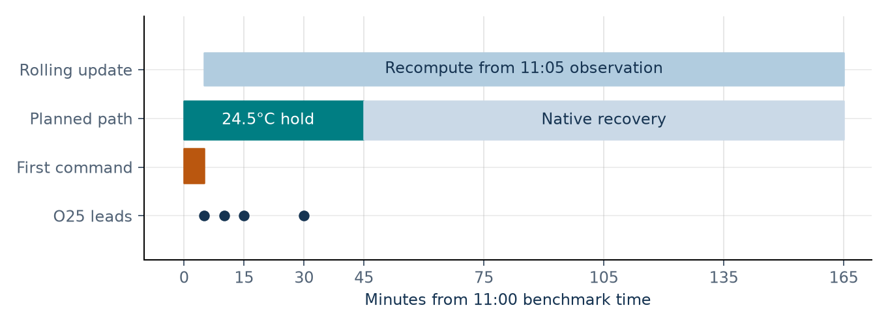
**Figure 3. Timing of the O25 leads, command interval and action-response plan.** Illustrative timeline derived from the recorded rolling origin and the fixed terminal time. At 11:05 the forecast is recomputed for 160 minutes; the first action has already executed. [FIG-003](../references/FIGURE_INDEX.md#fig-003)

Equation (9) represents the numerical fit and rollout in StepModel. Equation (10) is the guarded entry comparison. Continuation checks use the remaining supported warmed path and recovery. They cannot rank immediate economic release.

# Chapter 4 Concept Generation and Design Evaluation

A BOPTEST upgrade was justified by the need for scenario repetition, a documented physical boundary and checked actuator feedback. Causal data collection and exact activation timestamps were qualified independently from prediction accuracy and energy acceptance.

## 4.2.3 Transition to a Pinned Simulator

Implementation and evidence [SRC-002](../SDP_BOPTEST_Pilot/stage4e_d0/runner.py) [SRC-003](../SDP_BOPTEST_Pilot/stage4e_d2i_1/transport.py) [SRC-005](../SDP_BOPTEST_Pilot/stage4e_d2i_1_v1_0_1/collector.py) [DATA-003](../references/MODELS_AND_DATA.md#data-003).

The difficult issue in causal control was reliable inference provenance and actuation. Initial D1 work identified exact-boundary readback mismatch and failed the original qualification. The source-driven repair split validation of the documented event from post-event confirmation. It used versioned policies and independent evidence rather than relabeling the old run. Finished D1 v2 and D2 evidence then supported a dataset product with per-run metadata, a complete clock and explicit restrictions on training membership. A usable numerical feature is not necessarily one the controller could know at origin t. The data and software design enforce that difference.

The current BOPTEST configuration is a pinned local service with version, image identity and wrapped FMU hash checks. Runtime authorization is tied to an exact campaign and budget. A qualified origin enables only specified actions. An output receipt has to match both the simulation clock and the requested/effective control boundary before a step becomes measured evidence. A readback mismatch fails the attempt, and the consumed ledger prevents silently replacing it. The difference between this procedure and a generic simulation script is central to the reproducibility of the case studies in Chapter 5.

## 4.3.1 BOPTEST Dataset Generation and Counts

Implementation and evidence [SRC-005](../SDP_BOPTEST_Pilot/stage4e_d2i_1_v1_0_1/collector.py) [SRC-006](../ml_research_v1_0_0/dataset.py) [DATA-002](../references/MODELS_AND_DATA.md#data-002) [DATA-003](../references/MODELS_AND_DATA.md#data-003) [DATA-006](../references/MODELS_AND_DATA.md#data-006).

For D2, pair a native arm and a bounded X-policy arm within each weather/initialization group. Use a seven-day native warmup, 72 scored hours, 300 s advances and a 30 s historian. Capture standardized observations, a versioned archive of as-issued forecasts, committed commands, native control references, raw API records, safety state and post-action outcomes. If the timestep is wrong, a channel/forecast is missing, the readback is stale, time is nonmonotonic or values fail schema checks, quarantine the attempt or row according to the frozen version rather than interpolate across the gap. Guard states stay causal, with outcomes separate from inputs.

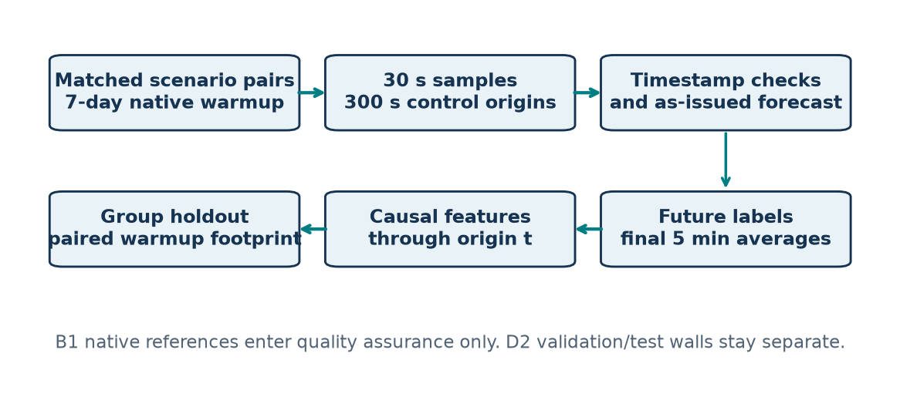
**Figure 4. D2 and B1 data generation and ML release process.** Illustrative diagram from the release, collector and adapter records. Paired runs share a dependence footprint and move together through the split. [FIG-004](../references/FIGURE_INDEX.md#fig-004)

| Corpus or protocol | Source grouping | Scored advances / usable joint origins | Purpose |
| --- | --- | --- | --- |
| D2 original development M0 | 8 groups, each with 2 runs | 13,824 advances / 13,632 origins | Same-origin outer-fold model comparison |
| B1 alternate C15/C45 | 4 runs across two already represented groups | 3,456 / 3,408 | Alternate durations. Transfer separate from D2 retention |
| B1 paired NREF | 2 runs in those groups | 1,728 / 1,704 | Equality, provenance and QA. Excluded from augmentation |
| Physical count in reconstruction | 22 included raw source records | 19,008 advances, 19,030 endpoints, 190,102 native samples | Source sizes across D2 and all B1 records |
| Original recommended D2 expansion plan | 16 nonoverlapping groups × 2 arms | Projected 27,264 candidate origins | Formal development, validation and protected allocation. A planned count is not training usage |

**Table 6. Dataset size arithmetic and scope boundaries.** Sources. Each scored run has 864 advances, 865 endpoints and 8,641 native timestamps. The frozen eligible ML surface contributes 852 origins per raw run after required past/horizon support. One run therefore contributes 72 h × 12 advances/h = 864 decisions and 8,640 thirty-second intervals, with endpoint samples counted once.

The four development folds hold complete scenario groups together. An observation from a native arm often shares weather, schedule and state history with its controlled counterpart. Splitting individual five-minute rows randomly would leak both autocorrelated overlap and action comparisons across train/test. The D2 protocol therefore binds group identity to forcing, warmup and experimental partner. The candidate scenario footprint also considers overlap of warmup and scored intervals. M0 uses 10,224 training origins and 3,408 held origins per fold. The combined reported held denominator is 13,632 observations, with eight dependence groups, one FMU and one TMY. More five-minute points do not create additional climates or independent occupancy behavior.

Mdiv changes action diversity at fixed training size and multiplicity. Its seed 20261118 replaces 426 of 852 paired times per augmented training group. Mfull adds eligible alternatives, so the four training folds have 11,928 or 13,632 origins and different relative group weight. B1 NREF observations remain QA only. Retention scores the same original origins, while transfer scores B1 alternatives on held groups. A performance change could reflect more action coverage, extra rows or changed mixing weights. Mdiv isolates only part of that question. Protected validation outcomes were not newly read or scored for this report.

## 4.3.2 Targets, Features and Leakage

Implementation and evidence [SRC-006](../ml_research_v1_0_0/dataset.py) [SRC-011](../ml_research_v1_0_0/inference.py) [MODEL-001](../references/MODELS_AND_DATA.md#model-001) [DATA-005](../references/MODELS_AND_DATA.md#data-005).

For horizon h, indoor temperature is the endpoint at t+h. Power targets are the averages over the interval [t+h−5 min,t+h], as defined by native sample integration. Cooling, fan and heating-thermal outputs are separate. Combined electricity is derived from cooling plus fan without a separate fitted building-demand target. Twenty-five observational features include selected current state, causal history/time encodings, as-issued forecasts and verified available control context. The  feature ledger covers 168 original candidate fields, rejecting constant, duplicate, unavailable or high-leakage predictors. The source reports identify 19 retained base definitions and additional features for common25. There are four horizons and 16 fitted component labels, with another four derived combined-power scores.

A29 keeps additional plan/control data under its contract. S23 is a state-oriented base and P27 adds proposal characteristics before committing a hypothetical action. Plan time and release time can be features only if known before the action. A realized future release or actual fallback is an outcome. Temporal joins use as-issued forecast vintages. Reconstructing a command plan with the post-event history would make offline accuracy look deceptively good. A stable control regime can still make an action feature uninformative if there is too little paired excitation to separate its effect.

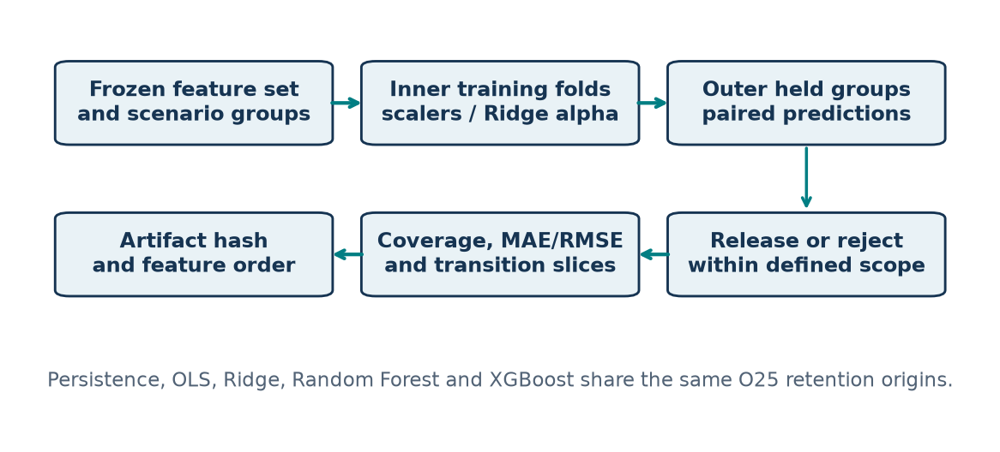
**Figure 5. Model comparison, fitting and release boundaries.** Illustrative workflow from the grouped training/evaluation code. Scalers and regularization choices are fitted in training, while the intact scenario group remains outside fitting to estimate transfer. [FIG-005](../references/FIGURE_INDEX.md#fig-005)

## 4.3.3 BOPTEST Forecast Model Selection and Comparisons

Implementation and evidence [SRC-011](../ml_research_v1_0_0/inference.py) [MODEL-001](../references/MODELS_AND_DATA.md#model-001) [DATA-004](../references/MODELS_AND_DATA.md#data-004) [DATA-005](../references/MODELS_AND_DATA.md#data-005).

Persistence and ordinary least squares give interpretable datums for every target. Ridge addresses correlated lags and standardized scales. The tree families model nonlinearity around equipment and weather thresholds. The frozen Random Forest preset uses 128 trees, depth 12, minimum leaf eight and a 0.8 feature fraction. XGBoost uses 240 stages, depth three, learning rate 0.05, minimum child weight five and histogram fitting. These presets, seeds and group folds are saved. The new research ran 208 fit cells and reused 16 fits. Appendix C contains all four horizon scores for five target quantities from the original O25 retained population.

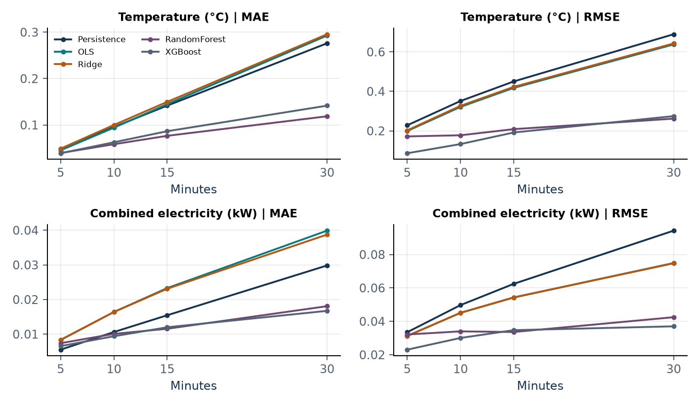
**Figure 6. O25 retention errors on the identical 13,632 development origins.** Derived from the frozen comparison CSV. XGBoost's short-lead advantages and the Forest's longer temperature performance show why selecting one artifact is a scope decision rather than a universal leaderboard result. [FIG-006](../references/FIGURE_INDEX.md#fig-006)

At +5 min combined electricity MAE was 0.005520 kW for persistence, 0.007395 for the selected Forest and 0.006553 for XGBoost. At +30 min it was 0.029826, 0.018076 and 0.016726 kW respectively. The Forest's +30 min temperature MAE/RMSE was 0.118680/0.261782°C, versus 0.276046/0.689517°C for persistence, and 0.141590/0.274623°C for XGBoost. These are grouped developmental scores. An intensive stable regime can make the relative improvement look large or small depending on the target, loss and lead.

Across the six feature-group removal families, indoor history and cooling/fan history were most consequential for many held scores. Removing indoor history increased +15 temperature MAE by roughly 0.743–1.455°C across assessed models in that screen. Removing electrical history increased the +15 combined MAE by about 0.073–0.136 kW. Clock/occupancy and weather groups changed performance differently depending on regime and model. A lower held score after removing some weather fields does not prove weather is physically irrelevant. The measured policy/season range, deterministic weather and dependencies constrain the inference.

The frozen practical margin required both MAE and RMSE to improve by at least 0.01 in target units, favorable group signs and bounded stable-native degradation. The broad augmentation contrasts did not pass across the full original or alternative populations. Improvements appeared at selected release-crossing windows, such as P27/Mdiv compared with S23/Mdiv on 18 of 32 alternative transfer contrast cells. Those are exploratory subgroup results on few groups. P27 is research evidence, not the operational controller's action model. O25/M0 Random Forest remained the selected observed-domain forecast.

# Chapter 5 Implementation and Fabrication

## 5.1 Current Implementation

The live entry point is `final_energy_control.digital_twin --rolling` under `SDP_BOPTEST_Pilot`. The local BOPTEST client and ordered transport handle simulator calls. The shared HTTP dashboard server provides verified state and action feedback. The original Stage 4D comfort-rule path has a different entry point. [SRC-001](../SDP_BOPTEST_Pilot/client.py) [SRC-002](../SDP_BOPTEST_Pilot/stage4e_d0/runner.py) [SRC-017](../SDP_BOPTEST_Pilot/final_energy_control/digital_twin.py) [SRC-023](../SDP_BOPTEST_Pilot/dashboard.py) [SRC-025](../SDP_BOPTEST_Pilot/final_energy_control/dashboard.html) [SRC-033](../SDP_BOPTEST_Pilot/stage4e_d1_v2/runtime.py).

### 5.1.1 Live Control, Safety and Failure Handling

Implementation and evidence [SRC-017](../SDP_BOPTEST_Pilot/final_energy_control/digital_twin.py) [SRC-018](../SDP_BOPTEST_Pilot/autonomous_hvac_stage1/controller.py) [SRC-019](../SDP_BOPTEST_Pilot/stage4e_d0/plan.py) [EXP-005](../SDP_BOPTEST_Pilot/final_energy_control/live_twin_evidence/LIVE_ROLLING_TWIN_01/batches/LIVE_ROLLING_TWIN_01/LIVE_CONFIGURATION.json).

Start first checks live authorization and runtime compatibility, then initializes a single simulator, warms the state under native control, and applies the configured step. At a verified origin the collector refreshes current conditions, verifies the observed state and the clock, and records the issued forecast. The policy computes candidate feasibility and predictions from information available at the cutoff. It checks the automatic control envelope before committing one command. It sends an advance, validates flags and effective values returned and reconciles the following native samples. Only a verified step updates the published frame.

Pause waits for a coherent BOPTEST step boundary. Resume revalidates the current endpoint before the next eligible call, preventing a stale UI value from standing in for an actual plant state. Stop queues safe native release where possible within the allowed budget and closes the instance. In the genuine rolling capture, a Stop request arrived while the final authorized advance was in flight and cleanup completed. No claim of a genuine forced mid-hold operator release is required. Offline lifecycle tests exercise additional paths.

The hold may only enter at the qualified time and keeps native heating. Temperature safety and missing-support checks can return native immediately at a qualified boundary. The upper safety guard is 25.5°C in the warmer-control policy. A commanded native release can start the 120-minute lockout, barring re-entry. If a response or effective actuator value cannot be verified, the attempt fails rather than guessing that a command worked. The registry consumes the current attempt and prohibits automatic replacements. The browser reads state and certifies no actuation on its own.

### 5.1.2 Forecast Presentation and Feedback

Implementation and evidence [SRC-012](../SDP_BOPTEST_Pilot/final_energy_control/live_smoke.py) [SRC-023](../SDP_BOPTEST_Pilot/dashboard.py) [SRC-024](../SDP_BOPTEST_Pilot/final_energy_control/live_dashboard.py) [SRC-025](../SDP_BOPTEST_Pilot/final_energy_control/dashboard.html) [EXP-005](../SDP_BOPTEST_Pilot/final_energy_control/live_twin_evidence/LIVE_ROLLING_TWIN_01/batches/LIVE_ROLLING_TWIN_01/LIVE_CONFIGURATION.json).

The observational panel states the source, origin and forecast horizon. In the rolling archive insufficient causal history and departure from the observational domain produce an unavailable state. Other historical routes can show a labeled persistence forecast. The action panel shows a separate predicted energy and temperature path, origin and allowed actions. The selected command and its actual readback are displayed separately. The final KPI can come from the BOPTEST API, while a partial prefix uses a replay of the same official schedule. The project temperature band has its own score and violation-duration row.

The new archive path checks the recorded artifact manifest and enables Play, Pause and seek. It opens the genuine rolling evidence and does not create an authorized live session. This is useful because the original live attempt is already consumed. G163 is a different replay with three measured trajectories. Its old predictive policy compared fixed paths at 11:00, and the view identifies it as fixed hold.

## 5.2 Verification and Reproducibility

Regression checks use sealed recordings and fabricated transports to verify claims about software, including clock and logic, restriction checks, fallback and cleanup. Genuine results require actual command and readback receipts and closed evidence. The core preserves complete seals for the rolling and G218 replays. The G174 and G163 calibration inputs are exact archived subsets. Complete historical replays and reintegration of other experiments use the original evidence archive. See [Windows launch instructions](../HOW_TO_RUN.md) and [verification status](../CORE_PACKAGE_VERIFICATION.md). [SRC-022](../SDP_BOPTEST_Pilot/autonomous_hvac_stage1/evaluation.py) [SRC-024](../SDP_BOPTEST_Pilot/final_energy_control/live_dashboard.py) [SRC-032](../scripts/Run-Regression.ps1) [SRC-033](../SDP_BOPTEST_Pilot/stage4e_d1_v2/runtime.py) [EXP-003](../SDP_BOPTEST_Pilot/final_energy_control/optimizer_runtime_state/batches/OPTIMIZER_G163_NATIVE_FIXED_PREDICTIVE/OPTIMIZER_COMPARISON.json) [EXP-005](../SDP_BOPTEST_Pilot/final_energy_control/live_twin_evidence/LIVE_ROLLING_TWIN_01/batches/LIVE_ROLLING_TWIN_01/LIVE_CONFIGURATION.json).

## 5.4 G174 Warmer Setpoint Control

Implementation and evidence [SRC-020](../SDP_BOPTEST_Pilot/core.py) [SRC-027](../SDP_BOPTEST_Pilot/energy_savings_g174_v1/comparison.py) [EXP-001](../SDP_BOPTEST_Pilot/energy_savings_g174_v1/runtime_state/batches/ESV01_G174_WARM45/PAIRED_ENERGY_COMFORT.json).

The initial BOPTEST interface pilots separated endpoint conventions from model behavior. An older D1 qualification stopped on an exact thermostat boundary mismatch, so its outcome remains failed. The D1 v2 validator documented native references around schedule changes and checked follow-up evidence without loosening the earlier historical record. Stage 4E and B1 then exercised native-reference and matched bounded cooling pulses. Across G174 and G146, the C15/C45 duration comparison commanded 296.90 K, or 23.75°C, for 15 or 45 minutes each scored day. Each C15 run delivered nine warmup-excluded pulse intervals and each C45 run delivered 27, with no vetoes. G174's common-window absolute room-temperature area increased from 0.197705 to 0.574141 K·h and G146's from 0.214932 to 0.586272 K·h. Full-period treatment electricity increased versus native by 0.013410/0.041300 kWh in G174 and 0.010432/0.033079 kWh in G146 for C15/C45. Similar within-group peaks but longer response support the intended duration contrast. The B1 phase passed its evidence-expansion objective. Its native-reference replays remained QA. A larger warming action was outside the earlier guard, so new frozen policies evaluated the 24.5°C exposure.

The G174 feasibility trial asked whether the warmer action could save energy on a cooling-active three-day development block. A single 45-minute 24.5°C cooling hold was scheduled each day at 11:00. The B1 native archive was usable because the team verified equivalence with the native comparator, including clock, warmup history and expected forcing. Cooling returned to native at 11:45 and each hold used a 120-minute recovery assessment. The arms shared BOPTEST BESTEST Air, native heating and the same TMY schedule. Energy was integrated at 30-second resolution over the 72 h scored period. The treatment saved 0.179067 kWh during the three holds, followed by 0.053921 kWh of additional recovery energy. Whole-period net saving was 0.078468 kWh (0.4027%). The difference between hold-plus-recovery and whole-period savings reflects all measured intervals, not a separate modeled adjustment.

Official discomfort rose from 1.404807 to 2.537502 K·h. Project discomfort rose from 0.102395 to 0.104585 K·h with 14.5 occupied violation minutes in both arms. Maximum occupied temperature rose from 27.050 to 27.061°C, while the in-hold and recovery behavior was scored separately. The 72 h energy signal survived recovery, yet G174 remained a frozen NO-GO on its comfort comparison. The study isolated a scheduled warming policy under an HVAC-active scenario. It did not establish favorable transfer to other weather, starts, setpoints or comfort definitions. This outcome led to the guarded predictor/action work and to examining what happened later in the day. Evidence.

## 5.5 G218 Stage 1 Warmer Setpoint Control

Implementation and evidence [SRC-022](../SDP_BOPTEST_Pilot/autonomous_hvac_stage1/evaluation.py) [SRC-028](../SDP_BOPTEST_Pilot/autonomous_hvac_stage1/g218.py) [EXP-002](../SDP_BOPTEST_Pilot/autonomous_hvac_stage1/g218_runtime_state/batches/G218_STAGE1_NATIVE_AUTONOMOUS/PAIRED_VALIDATION.json).

G218 asked whether the first autonomous guard could select and deliver a qualified warmer intervention while preserving the whole-period limits. It compared two fresh matched arms over 72 h following seven-day native warmup. The same causal boundary forecasts and native states were verified. The controller considers only a 45-minute 11:00 opportunity, checks sustained cooling, observed temperature, predicted/guarded margin and history, and reverts to native. All three daily holds ran, totaling 27 verified warm intervals. There were no safety vetoes or fallbacks. The peak hold of 24.567°C met the 25.5°C guard. The native recovery marker was 20, 15 and 15 minutes after the corresponding releases, inside the 120-minute window.

| G218 score over 72 h | Native | Stage 1 | Stage 1 minus native |
| --- | ---: | ---: | ---: |
| Cooling electricity (kWh) | 14.308948 | 14.241291 | −0.067657 |
| Fan electricity (kWh) | 0.557802 | 0.550539 | −0.007263 |
| Cooling plus fan (kWh) | 14.866750 | 14.791830 | −0.074920 |
| Official discomfort (K·h) | 1.104555 | 2.240787 | +1.136232 |
| Project discomfort (K·h) | 0.052414 | 0.053100 | +0.000686 |
| Occupied project violation (min) | 5.0 | 5.0 | 0 |

**Table 9. G218 Stage 1 matched electricity and thermal evaluation.** Source. The frozen whole-period energy and hold-plus-recovery gates passed, while the added project severity exceeded the comparison tolerance.

The holds saved 0.167667 kWh. Recovery consumed 0.050383 kWh more than native, leaving 0.117284 kWh after paired recovery. Over the rest of the comparison the controlled arm used about 0.042365 kWh more, leaving 0.074920 kWh net (0.5039%). This sign and magnitude matter for hypothesis testing. A fixed period showing a reduction during the command cannot guarantee the same amount survives later equipment operation.

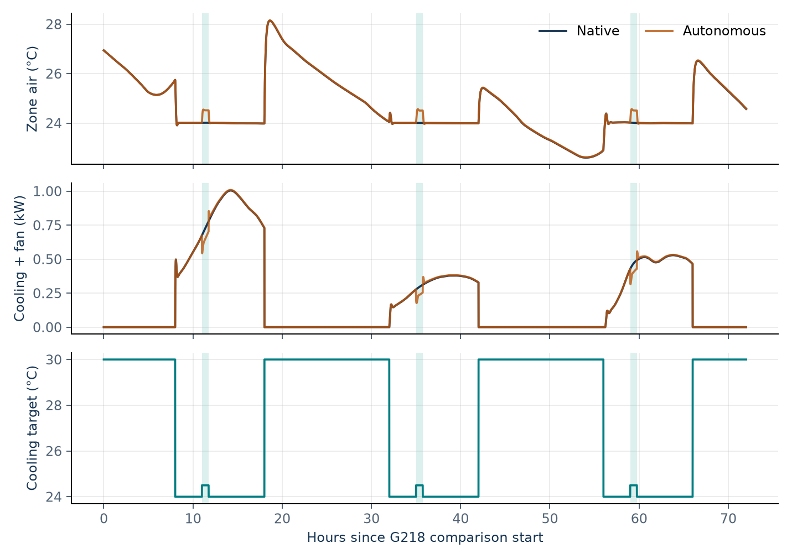
**Figure 10. Full G218 Stage 1 trajectories and the three morning holds.** Derived from both sealed 30-second histories. The lower panel shows the effective control, including evening setback. The alignment permits comparisons against the native response in the same scenario. [FIG-010](../references/FIGURE_INDEX.md#fig-010)

The schedule alignment audit independently recomputed the official and project results from the resources and both histories. At 18:00 the thermostat switches nominally, while the pinned benchmark resource's 10-minute grid retains the occupied bounds until 18:10. The source generator keeps the pre-transition duplicate row at 18:00. The resource defines the KPI clock. The rationale for that special case is unverified. Both arms exceeded 26°C from 18:05:00 to 18:09:30 at 30-second instants. Ten opening-sample intervals yield five violation minutes, while the trapezoidal replay spans eleven contributing intervals from a half-weight leading to a half-weight trailing endpoint. The 0.000686102619 K·h difference is exactly explained by the two temperature traces under the same scoring rules. The causal explanation for the small evening gap is unresolved.

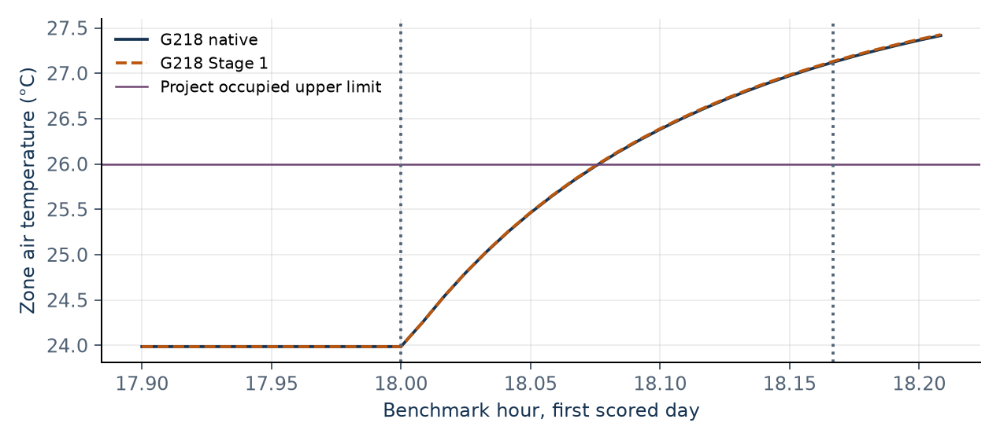
**Figure 11. Late-day G218 temperature around the thermostat and comfort transitions.** Derived from the sealed Stage 1 histories. The two vertical rules show 18:00 and 18:10. Both arms have the same violation duration, with a small difference in degree-hour severity. [FIG-011](../references/FIGURE_INDEX.md#fig-011)

### 5.5.1 Optional 400 W Morning Guard

Implementation and evidence [EXP-010](../SDP_BOPTEST_Pilot/autonomous_hvac_stage1/g400.py).

The archived morning and evening audit proposed an illustrative risk veto from cooling load. The optional guard integrates 61 verified native samples between 10:25 and 10:55. At 11:00 a mean cooling power at or above 400 W or insufficient valid causal history vetoes the warmer start. Below threshold, Stage 1 still decides. The guard has offline tests, but the prospective G299 matched campaign has no recorded execution ledger. The later genuine rolling demonstration had this optional guard off. The association seen in a handful of same-weather-year blocks is insufficient to claim that the veto prevents late-day violation or improves energy.

## 5.6 G163 Three-Arm HVAC Optimizer Comparison

Implementation and evidence [SRC-015](../SDP_BOPTEST_Pilot/final_energy_control/optimizer.py) [SRC-024](../SDP_BOPTEST_Pilot/final_energy_control/live_dashboard.py) [SRC-028](../SDP_BOPTEST_Pilot/autonomous_hvac_stage1/g218.py) [EXP-003](../SDP_BOPTEST_Pilot/final_energy_control/optimizer_runtime_state/batches/OPTIMIZER_G163_NATIVE_FIXED_PREDICTIVE/OPTIMIZER_COMPARISON.json).

The fixed-path predictive controller offered a first quantitative test of whether ranking calibrated native and warmer 165-minute paths could improve over native and over applying the fixed warmer action each day. G163 contained three independently initialized but forcing-matched 72 h arms. Each recorded 864 five-minute advances and 8,641 native timestamps. The fixed warmer arm delivered its three scheduled holds. The predictive fixed-hold arm selected native on day 1 when the entry state or weather fell outside the calibrated envelope, then delivered two warmer holds on days 2 and 3. Recovery used native control. All arms completed with verified cleanup. These exact settings identify the G163 comparator.

| Measure | Native | Fixed 24.5°C | Predictive fixed hold |
| --- | ---: | ---: | ---: |
| Cooling (kWh) | 15.899675 | 15.832631 | 15.850229 |
| Fan (kWh) | 0.623608 | 0.615971 | 0.617833 |
| Combined (kWh) | 16.523282 | 16.448602 | 16.468062 |
| Net saving vs native (kWh) | 0 | 0.074680 | 0.055221 |
| Net saving vs native (%) | 0 | 0.4520 | 0.3342 |
| Official discomfort (K·h) | 1.298754 | 2.431626 | 2.054106 |
| Project discomfort (K·h) | 0.053918 | 0.055653 | 0.055002 |
| Occupied violation (min) | 11.5 | 11.5 | 11.5 |
| Verified holds and native releases | 0 | 3 | 2 |

**Table 10. G163 sealed three-arm comparison.** Source. Controlled arms passed the frozen 0.0225 kWh energy minimum and failed the no-added full-period project criterion. The figures are measured BESTEST Air responses.

The predictive fixed-hold arm used 0.019459 kWh more than the fixed warmer arm. It produced 0.377520 K·h less official discomfort than fixed warmer, and about 0.000651 K·h less project discomfort. Both still exceeded native severity. All three had 11.5 violation minutes, with 26.697°C native and 26.708°C controlled occupied peaks when rounded to 0.001°C. Day 1's withheld intervention caused the main policy difference. That is a demonstrated consequence of the envelope check, not proof that a tighter or looser envelope would generalize better. The three-arm verdict cannot be attached to the later rolling implementation because the rolling policy has no matched third arm in G163.

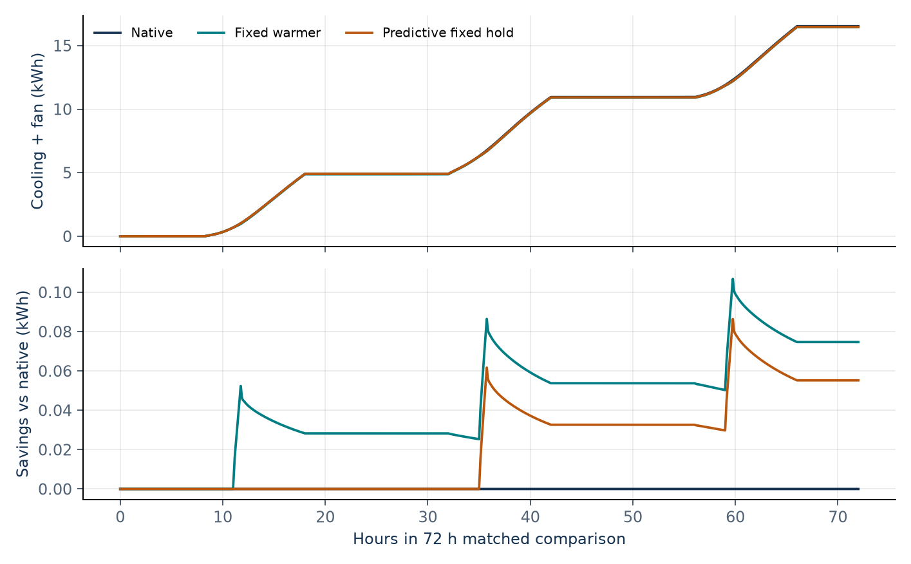
**Figure 12. G163 measured cumulative combined electricity and difference from native.** Derived independently from all three 30-second trajectories. Plotting savings separately makes sub-0.1 kWh changes visible on a total of roughly 16.5 kWh. [FIG-012](../references/FIGURE_INDEX.md#fig-012)

## 5.7 Original Fixed-Hold Live Digital Twin Dashboard

Implementation and evidence [SRC-013](../SDP_BOPTEST_Pilot/final_energy_control/optimizer_model.py) [SRC-017](../SDP_BOPTEST_Pilot/final_energy_control/digital_twin.py) [EXP-004](../SDP_BOPTEST_Pilot/final_energy_control/live_twin_evidence/LIVE_OPTIMIZER_TWIN_01/batches/LIVE_OPTIMIZER_TWIN_01/LIVE_CONFIGURATION.json).

`LIVE_OPTIMIZER_TWIN_01` asked whether the qualified fixed-path policy could execute an automatically selected hold in a real BOPTEST session. This was a single-arm functionality test. One authorized instance with a seven-day warmup executed 41 verified 300 s steps from 10:20 to 13:45 on benchmark day offset 218. A3 was selected at 11:00. It predicted 2.12250 kWh over 165 min versus 2.16308 kWh for native. Its predicted difference was 0.04058 kWh or 0.03425 kWh after the model uncertainty deduction. The confirmed 24.5°C hold ran for 45 minutes and released to native. O25 and the displayed measured feedback used their separate provenance fields.

The native pre-hold, hold, and recovery windows measured about 0.42013, 0.48123 and 1.81499 kWh respectively. The run recorded about 2.71635 kWh, official discomfort 0.424717 K·h, no project-band violation, and a 24.549°C occupied peak. A native baseline was not part of this experiment. Even a numerically identical baseline from another type of comparison would need a defined, verified match before interpreting any difference as savings. Cleanup was verified and the exact authorization is consumed.

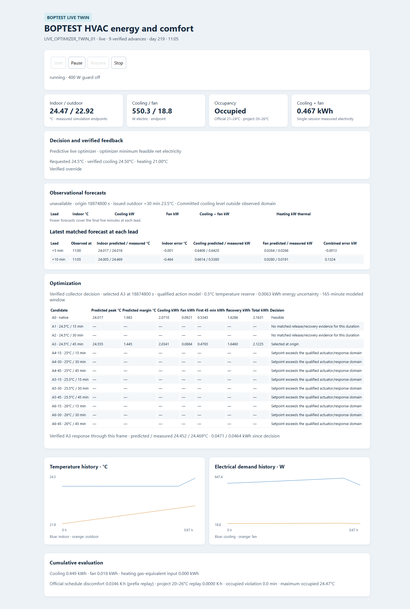
**Figure 13. Genuine fixed-path optimizer running in Chrome.** Archived capture of `LIVE_OPTIMIZER_TWIN_01`. Candidate energy values are model predictions. The command confirmation and room state come from the live BOPTEST response. [FIG-013](../references/FIGURE_INDEX.md#fig-013)

## 5.8 Rolling HVAC Controller

Implementation and evidence [SRC-014](../SDP_BOPTEST_Pilot/final_energy_control/rolling_model.py) [SRC-016](../SDP_BOPTEST_Pilot/final_energy_control/rolling_control.py) [SRC-017](../SDP_BOPTEST_Pilot/final_energy_control/digital_twin.py) [MODEL-002](../SDP_BOPTEST_Pilot/final_energy_control/rolling_model.py).

The next design asked whether a controller could refresh the expected remaining path at each verified observed state and safely decide whether continued use of the qualified hold was supported. It retained the 11:00 start and the native release at 11:45 or earlier for safety, followed by the 120-minute lockout. Compared with fixed hold, it updates the response prediction and validity every five minutes. The two warm and native paths in the qualification archives had prior completed runs in G174 and G218. Held G163 data assessed matched prediction direction, bounded temperatures and recovery. The evidence covers a small number of physical-equivalent operating conditions.

| Archived held G163 forecast lead | Origins | Indoor MAE / RMSE (°C) | Cooling / fan cumulative MAE (kWh) |
| --- | ---: | ---: | ---: |
| 5 min | 198 | 0.00581 / 0.00705 | 0.000268 / 0.000018 |
| 30 min | 168 | 0.00598 / 0.00716 | 0.005759 / 0.000356 |
| 60 min | 132 | 0.00634 / 0.00754 | 0.022188 / 0.001360 |
| 165 min | 6 | 0.00872 / 0.01125 | 0.175528 / 0.011345 |

**Table 11. Frozen archived rolling-model accuracy and coverage.** Source, `MEASURED_MODEL_VALIDATION.json`. Repeated forecast origins come from one held development scenario, and availability declines with lead.

The paired energy ranking was correct on three matched entry pairs and the largest error in the predicted paired saving was about 0.00504 kWh. This can coexist with appreciably larger absolute 165-minute cumulative cooling error for either candidate, since errors may cancel in the paired difference. Exclusions when fitting to only one alternate scenario were substantial. There were no actual occupied 26°C violations in the qualified scored windows, which means violation sensitivity was not measured. The model can reject unsupported states or weather. It cannot use a prediction for an arbitrary unobserved control sequence.

### 5.8.1 Genuine Rolling HVAC Controller Session

Implementation and evidence [SRC-012](../SDP_BOPTEST_Pilot/final_energy_control/live_smoke.py) [SRC-017](../SDP_BOPTEST_Pilot/final_energy_control/digital_twin.py) [SRC-025](../SDP_BOPTEST_Pilot/final_energy_control/dashboard.html) [EXP-005](../SDP_BOPTEST_Pilot/final_energy_control/live_twin_evidence/LIVE_ROLLING_TWIN_01/batches/LIVE_ROLLING_TWIN_01/LIVE_CONFIGURATION.json).

`LIVE_ROLLING_TWIN_01` completed 41 five-minute advances, with 411 thirty-second samples, 446 receipt-journal entries and a verified instance removal. The opportunity began at 11:00 on benchmark day offset 218. The application recorded one warm start, eight subsequent warm continuations, one scheduled release and 31 native-control decisions. The optional 400 W guard was off. There were no safety-triggered releases. BOPTEST's measured cooling and fan electricity were 2.599870 and 0.116477 kWh, giving 2.716347 kWh combined. Applying Eq. (6) to the two raw power channels reproduced these values. The run recorded 0.424717 K·h official discomfort and 0 K·h / 0 occupied minutes on the project score. Its scope is successful closed-loop operation during one recorded scenario.

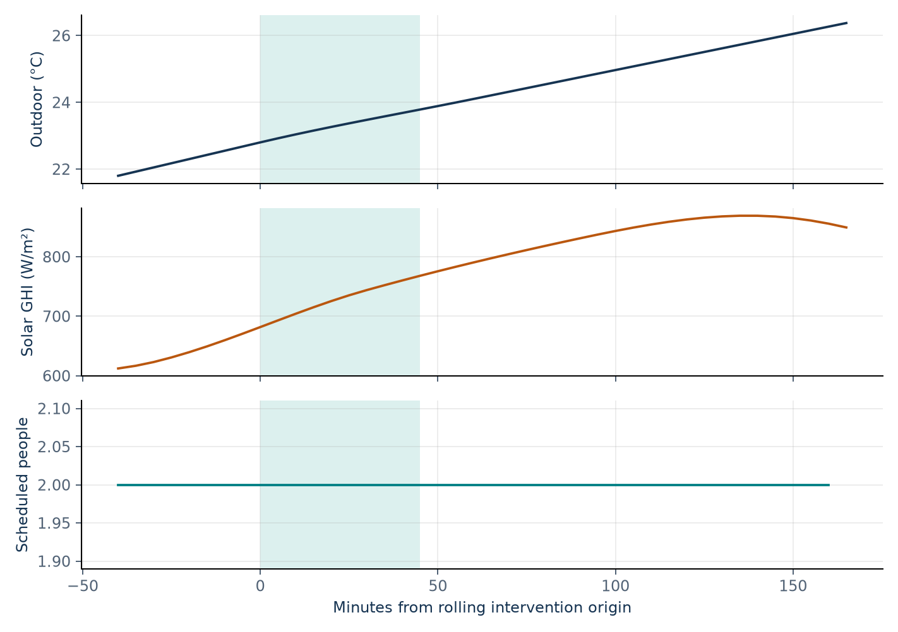
**Figure 14. Rolling session weather and occupancy at and around the hold.** Derived from verified endpoints and the zero-lead data in the recorded forecast vintages. Occupancy is a scripted BOPTEST input. Shading marks the delivered 45-minute hold. [FIG-014](../references/FIGURE_INDEX.md#fig-014)

| Origin and observed state | Decision or prediction | Verification and what it means |
| --- | --- | --- |
| 10:55, eligible native feature history | O25 produces +5/+10/+15/+30 observational forecasts | The following 11:00 endpoint is a verified measurement. Forecasts beyond the action may cross a policy change |
| 11:00, only A0/A1 considered | 2.23787 kWh predicted for native, 2.19515 kWh for warm + recovery | Difference 0.04272 kWh, or 0.03568 after uncertainty and switching deductions. Issued only the next five-minute warm command |
| 11:05, verified 24.5°C and measured 24.469°C room | Recomputed remaining 160 min. Predicted 2.11996 kWh and next indoor temperature 24.555°C | Next indoor readback about 24.548°C. Early release as an economic alternative has no qualified counterfactual |
| 11:15, measured warmer trajectory | Recomputed 150 min plan, predicted remaining 2.03884 kWh and next temperature 24.519°C | Verified corresponding next temperature about 24.521°C |
| 11:45 scheduled native release | Release external cooling flag, resume 24°C | Verified 11:50, finish 120 min of native recovery by 13:45 |

**Table 12. Measured control loop and candidate predictions at specific origins.** Sources frozen decision log, forecast records and verified endpoints. Planned energies are conditional predictions. Single-arm execution records consumption and leaves comparative savings undetermined.

The BOPTEST Forecast Model contributed 25 valid live origins and 92 forecast targets whose outcome lies within the captured record. For the nine committed 24.5°C steps, the BOPTEST Forecast Model reports unavailable under its observed-domain contract. Before entry and during recovery it can supply its own short leads. The BOPTEST Forecast Model record at origin 10:55 includes indoor temperature predictions of 24.01654, 24.00463, 23.99164 and 23.92800°C. The corresponding combined electric power predictions are 0.66724, 0.68947, 0.71742 and 0.75435 kW, each averaging the final five minutes of its lead. Only the HVAC Action-Response Model can differentiate the eligible candidate trajectories.

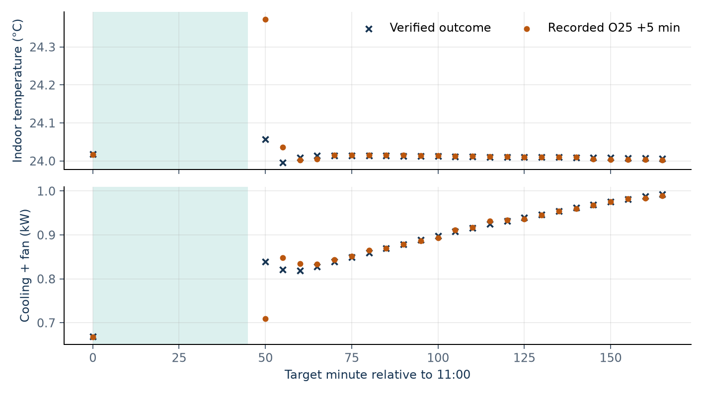
**Figure 15. BOPTEST Forecast Model +5 min forecasts compared with verified outcomes in the rolling run.** Derived from recorded forecasts, endpoints and integrated 30-second samples. Gaps are intentional where the model would decline to forecast. One session is a demonstration of feedback and availability. [FIG-015](../references/FIGURE_INDEX.md#fig-015)

Read Figures 16–19 in order. the BOPTEST Forecast Model gives lead-time forecasts from observed native operation. The action-response table gives conditional estimates for candidate commands. The decision and verified feedback panel records what the simulator accepted at the next observation. The recovery lockout follows verified release.

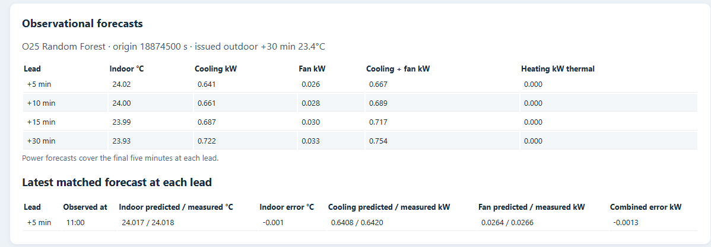
**Figure 16. Observational BOPTEST Forecast Model outputs at the native-to-hold boundary.** Cropped from a genuine archived Chrome capture. The upper table lists the four forecast leads. The lower table shows the available +5 min match and its recorded outcome. The figure index links the original capture. [FIG-016](../references/FIGURE_INDEX.md#fig-016)

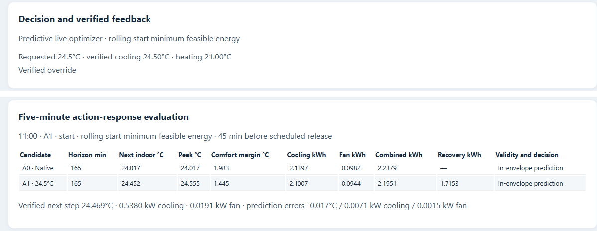
**Figure 17. Action-response choice issued at 11:00 and first warm readback.** Cropped from a genuine archived Chrome capture. The decision issued at 11:00 has a verified 24.5°C cooling readback at 11:05. The candidate energy values are predictions. The figure index links the original capture. [FIG-017](../references/FIGURE_INDEX.md#fig-017)

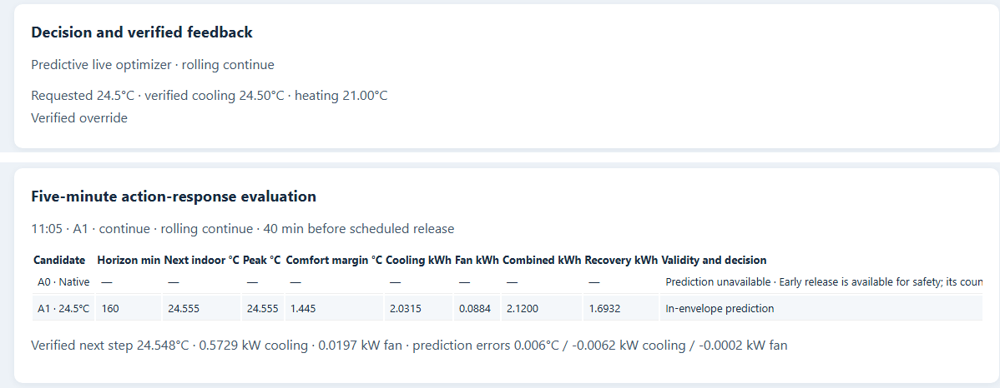
**Figure 18. Next rolling continuation recalculated from a new verified observation.** Cropped from a genuine archived Chrome capture. The next observation gives a new continuation forecast. The live display clips the release explanation at the right edge. The decision log records that economic early release is unqualified and safety release remains available. The figure index links the original capture. [FIG-018](../references/FIGURE_INDEX.md#fig-018)

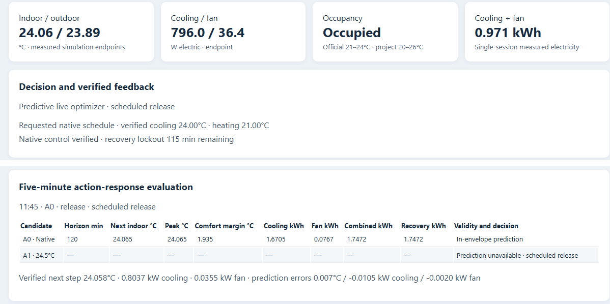
**Figure 19. Verified scheduled release and recovery.** Cropped from a genuine archived Chrome capture. The override is cleared, the effective cooling target returns to 24°C, and the recovery lockout is visible in verified feedback. The figure index links the original capture. [FIG-019](../references/FIGURE_INDEX.md#fig-019)

### 5.8.2 Prepared Continue-versus-Release Branch

Implementation and evidence [SRC-031](../SDP_BOPTEST_Pilot/final_energy_control/release_branch.py) [EXP-009](../SDP_BOPTEST_Pilot/final_energy_control/release_branch.py).

The archives include known warm continuations and native recoveries that begin at 11:45. They do not contain matched alternatives at 11:15 that separate a five-minute continuation from immediate release. A prepared campaign, `G218_RELEASE_BRANCH_1115_01`, would replay matched native warmup and the same history up to 11:15, then branch once. One arm would continue 24.5°C for five more minutes and release at 11:20, while the other would release at 11:15. Both would continue native to 13:45. The pinned FMU does not declare state cloning/serialization support, so the plan uses deterministic pre-fork comparison of initialization, commands, observations and issued forcing. Its designed budget is 41 advances per arm, 82 total, with no retries. Offline transport checks passed. No live execution or measured increment is recorded. Economic early release, delayed starts and re-entry remain disabled.

## 5.9 Fan Control Experiment and Independent Replication

Implementation and evidence [SRC-029](../SDP_BOPTEST_Pilot/final_energy_control/fan_trial.py) [EXP-006](../SDP_BOPTEST_Pilot/final_energy_control/fan_trial_evidence/G218_FAN060_1400_01/batches/G218_FAN060_1400_01/FAN_COMPARISON.json) [EXP-007](../SDP_BOPTEST_Pilot/final_energy_control/fan_trial_evidence/G258_FAN060_1400_01/batches/G258_FAN060_1400_01/FAN_COMPARISON.json).

The fan experiment asks whether cooling-plus-fan electricity can be reduced while preserving the native room cooling target. Reducing fan flow changes both fan power and the ability to remove heat. A genuine benefit would need to survive native recovery, and an acceptable policy must respect its declared temperature assessment. G218 fan-only used two 36-step matched arms, beginning 13:30 after seven native warmup days. At 14:00 the treatment reduced the fan command to 0.60 for six advances and recorded approximately 0.330 kg/s endpoint flow. Cooling/heating remained at native 24/21°C. The supply temperature remained under native control. At 14:30 the fan returned to native and recovery continued for two hours. Identical forcing and matched prefix were verified along with release and cleanup.

G218 saved 0.008308 kWh during intervention and spent an additional 0.003129 kWh during recovery, leaving 0.005179 kWh (0.1809%) over the complete three-hour window. Fan electricity fell from 0.135131 to 0.130029 kWh. Cooling electricity over the full period changed only from 2.727371 to 2.727294 kWh. The intervention mean room temperature was about 0.0397°C higher and the largest paired warming was approximately 0.131°C. Official discomfort rose from 0.003677 to 0.023761 K·h. Project-band discomfort and violation duration were both zero. This trial passed its eight provisional checks, which assessed project-band comfort and did not require zero added official discomfort. Its official increase was retained as an engineering cost.

G258 repeated the same fan command on another development time block using an independently qualified matched pair with the same duration, native cooling and measurement protocol. “Independent replication” here identifies a distinct scenario selection within the same model and TMY, rather than a second building or climate. The G258 native air and weather demand were verified before approval. The fan-only trial saved 0.010300 kWh in the hold and used 0.003991 kWh more during recovery. Whole-window electricity fell from 2.987869 to 2.981561 kWh, a 0.006308 kWh (0.2111%) saving. The maximum paired warming was about +0.158°C at 14:04. Official discomfort increased by 0.024559 K·h, while project-band minutes were zero. Again the original provisional criteria passed and the official cost remained. This consistency suggested testing an initial sensible-compensation strategy, without promoting fan-only control.

## 5.10 G258 Joint HVAC Control Experiment

Implementation and evidence [SRC-020](../SDP_BOPTEST_Pilot/core.py) [SRC-030](../SDP_BOPTEST_Pilot/final_energy_control/joint_fan_trial.py) [EXP-008](../SDP_BOPTEST_Pilot/final_energy_control/fan_trial_evidence/G258_JOINT060_1400_01/batches/G258_JOINT060_1400_01/JOINT_COMPARISON.json).

This trial tested whether compensating for reduced airflow with a colder fixed supply setpoint could reduce the early warming while keeping net electricity savings. The new control strategy used the same G258 benchmark scenario as the preceding fan-only trial and a new matched native arm. The two separate native datasets match for indoor temperature and cooling/fan power at their recorded timestamps. Arm B used fresh verified inputs at 14:00 to calculate Eq. (5), then kept the two commands fixed for the full 30 minutes. The recorded command was fan 0.60 with a 288.34751 K effective supply-temperature readback. All six planned joint steps verified. Both overrides were cleared at 14:30 and observed clear at 14:30:30. The two-hour recovery was completed. The technical capture includes 36 verified steps per arm and zero control abnormalities, heating or safety vetoes.

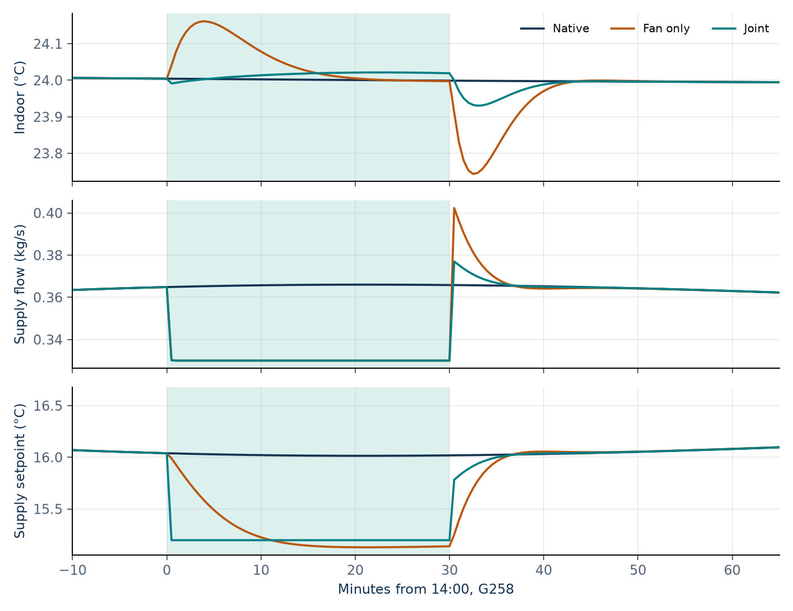
**Figure 20. G258 actuation and measured room temperature for the native, fan-only and joint paths.** Derived from the distinct sealed G258 pairs. The supply trace shows the effective setpoint. Joint compensation limits the initial warming, while the native control response after release differs. [FIG-020](../references/FIGURE_INDEX.md#fig-020)

| Measure | G258 native | Fan-only treatment | Joint treatment |
| --- | ---: | ---: | ---: |
| Full-run cooling electricity (kWh) | 2.843649 | 2.843546 | 2.843436 |
| Full-run fan electricity (kWh) | 0.144220 | 0.138015 | 0.137644 |
| Combined electricity (kWh) | 2.987869 | 2.981561 | 2.981080 |
| Intervention saving (kWh) | 0 | 0.010300 | 0.008287 |
| Post-release recovery penalty (kWh) | 0 | 0.003991 | 0.001498 |
| Whole-window saving (kWh) | 0 | 0.006308 | 0.006789 |
| Whole-window saving (%) | 0 | 0.2111 | 0.2272 |
| Official discomfort (K·h) | 0.004464 | 0.029022 | 0.011154 |
| Project discomfort / occupied violations | 0 K·h / 0 min | 0 K·h / 0 min | 0 K·h / 0 min |

**Table 13. Verified G258 fan-only and joint comparisons against their matched native references.** Sources. The two separate native records match on the plotted channels. The positive recovery penalty is separately integrated.

Read each G258 treatment against its own native arm. The native records have the same values at the displayed precision. Whole-window saving subtracts treatment electricity from native electricity. A positive recovery penalty means the treatment used more after release and reduces the intervention saving. K·h combines the size and duration of a temperature exceedance. The official and project comfort bounds can therefore give different results for the same measured temperatures.

Subtracting 2.9810800427 kWh from 2.9878687113 kWh gives 0.0067886686 kWh, or 0.2272077%. Joint control reduced the added official discomfort by about 73% relative to fan-only and improved net saving by only 0.000481 kWh. Relative to its own native arm, mean paired room temperature was +0.01295°C during intervention and close to zero over the full period. The largest positive paired difference was +0.02158°C at 14:24:30. The largest absolute difference was −0.06804°C at 14:33. An apparently zero full-period mean masks this shorter thermal behavior. The frozen gate required no additional official discomfort. The +0.0066905 K·h increase therefore made the result an acceptance FAIL despite valid delivery, positive energy savings, and zero additional project severity or violation time.

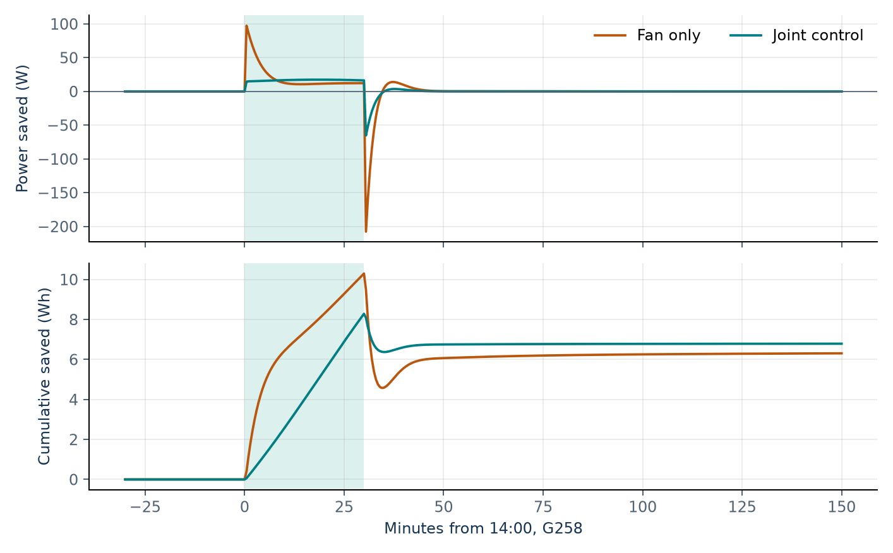
**Figure 21. G258 power difference and cumulative saving through two hours of native recovery.** Derived from the paired, sealed 30-second histories. A recovery load can erode part of the initial energy reduction; positive cumulative values are net savings vs native. [FIG-021](../references/FIGURE_INDEX.md#fig-021)

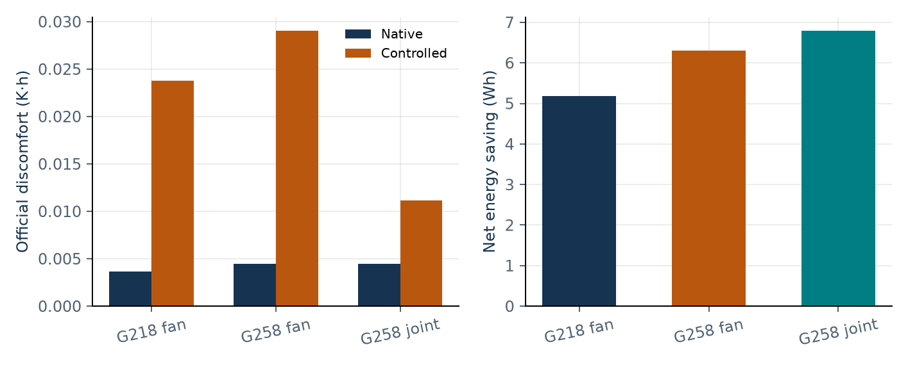
**Figure 22. Official discomfort and net electricity saving across the three fan/joint trials.** Derived from the sealed comparison JSON files. Project-band discomfort and occupied minutes were zero for all of these arms. The two comfort tests have different thresholds and the original acceptance logic differs by campaign. [FIG-022](../references/FIGURE_INDEX.md#fig-022)

### 5.10.1 Interpretation and Causal Limits

Implementation and evidence [SRC-022](../SDP_BOPTEST_Pilot/autonomous_hvac_stage1/evaluation.py) [EXP-006](../SDP_BOPTEST_Pilot/final_energy_control/fan_trial_evidence/G218_FAN060_1400_01/batches/G218_FAN060_1400_01/FAN_COMPARISON.json) [EXP-007](../SDP_BOPTEST_Pilot/final_energy_control/fan_trial_evidence/G258_FAN060_1400_01/batches/G258_FAN060_1400_01/FAN_COMPARISON.json) [EXP-008](../SDP_BOPTEST_Pilot/final_energy_control/fan_trial_evidence/G258_JOINT060_1400_01/batches/G258_JOINT060_1400_01/JOINT_COMPARISON.json).

A 30-minute intervention affects a short fraction of a three-hour measured window. Fan watts are small relative to cooling watts at these origins. Cooling and recovery can offset a portion of the fan reduction, as the separated hold/recovery values show. G258 joint reduced the recovery penalty over fan-only by about 0.002493 kWh but also saved about 0.002013 kWh less during the hold. The measured difference in net benefit is only their residual. Constant COP, idealized coil actuation and regular benchmark schedules simplify these mechanisms. The room and meter traces support statements about timing, readbacks, and integrated differences in the FMU. They do not identify all latent/thermal/controller contributions or establish similar gains in a different plant.

## 5.12 Comparative Outcomes

Electricity figures below are whole-window cooling-plus-fan totals. Percent savings use each campaign's native arm denominator. Only two project-band fan screens provisionally passed. Both increased official discomfort. The separately defined joint zero-added-official-discomfort criterion failed. [EXP-001](../SDP_BOPTEST_Pilot/energy_savings_g174_v1/runtime_state/batches/ESV01_G174_WARM45/PAIRED_ENERGY_COMFORT.json) [EXP-002](../SDP_BOPTEST_Pilot/autonomous_hvac_stage1/g218_runtime_state/batches/G218_STAGE1_NATIVE_AUTONOMOUS/PAIRED_VALIDATION.json) [EXP-003](../SDP_BOPTEST_Pilot/final_energy_control/optimizer_runtime_state/batches/OPTIMIZER_G163_NATIVE_FIXED_PREDICTIVE/OPTIMIZER_COMPARISON.json) [EXP-006](../SDP_BOPTEST_Pilot/final_energy_control/fan_trial_evidence/G218_FAN060_1400_01/batches/G218_FAN060_1400_01/FAN_COMPARISON.json) [EXP-007](../SDP_BOPTEST_Pilot/final_energy_control/fan_trial_evidence/G258_FAN060_1400_01/batches/G258_FAN060_1400_01/FAN_COMPARISON.json) [EXP-008](../SDP_BOPTEST_Pilot/final_energy_control/fan_trial_evidence/G258_JOINT060_1400_01/batches/G258_JOINT060_1400_01/JOINT_COMPARISON.json).

| Matched treatment | Native → treatment kWh | Saving kWh | Official K·h, native → treatment | Frozen outcome |
| --- | --- | --- | --- | --- |
| G174 fixed warmer | 19.485982 → 19.407514 | 0.078468 | 1.404807 → 2.537502 | NO-GO |
| G218 Stage 1 | 14.866750 → 14.791830 | 0.074920 | 1.104555 → 2.240787 | Project comfort fail |
| G163 fixed warmer | 16.523282 → 16.448602 | 0.074680 | 1.298754 → 2.431626 | Project comfort fail |
| G163 predictive fixed hold | 16.523282 → 16.468062 | 0.055221 | 1.298754 → 2.054106 | Project comfort fail |
| G218 fan-only | 2.862502 → 2.857323 | 0.005179 | 0.003677 → 0.023761 | Project-band screen passed, official worsened |
| G258 fan-only | 2.987869 → 2.981561 | 0.006308 | 0.004464 → 0.029022 | Project-band screen passed, official worsened |
| G258 joint | 2.987869 → 2.981080 | 0.006789 | 0.004464 → 0.011154 | Official comfort fail |

**Table C. Measured energy and official comfort.** Each warmer comparison spans 72 h. Fan and joint comparisons span 3 h. The genuine live sessions are single-arm demonstrations.

# Chapter 6 Conclusions

## 6.1 Verified Capability

The pinned BOPTEST loop validates an observation, forecast, decision, bounded action, verification and recovery workflow. The partial Rolling HVAC Controller recomputes supported continuations every five minutes. Its live record has no matched native comparator. The strongest saved-energy result within a campaign remains subject to that campaign’s original comfort test. The package is ready for a recorded BOPTEST system demonstration. [EXP-002](../SDP_BOPTEST_Pilot/autonomous_hvac_stage1/g218_runtime_state/batches/G218_STAGE1_NATIVE_AUTONOMOUS/PAIRED_VALIDATION.json) [EXP-003](../SDP_BOPTEST_Pilot/final_energy_control/optimizer_runtime_state/batches/OPTIMIZER_G163_NATIVE_FIXED_PREDICTIVE/OPTIMIZER_COMPARISON.json) [EXP-005](../SDP_BOPTEST_Pilot/final_energy_control/live_twin_evidence/LIVE_ROLLING_TWIN_01/batches/LIVE_ROLLING_TWIN_01/LIVE_CONFIGURATION.json) [EXP-008](../SDP_BOPTEST_Pilot/final_energy_control/fan_trial_evidence/G258_JOINT060_1400_01/batches/G258_JOINT060_1400_01/JOINT_COMPARISON.json).

## 6.2 Technical Limits and Future Work

The evidence covers a single highly idealized zone, one typical meteorological year and correlated weather-group histories. The Action-Response Model uses weather persistence beyond its +30-minute vintage and has few long-horizon validation origins. Early economic release, delayed starts, re-entry, stronger setpoints and joint actuator policies require new supported counterfactual evidence. The prepared 11:15 branch cannot establish an energy or comfort result. A field deployment would also require separate calibration, sensor reliability, actuator commissioning and agreement about comfort and fallback. [SRC-014](../SDP_BOPTEST_Pilot/final_energy_control/rolling_model.py) [SRC-031](../SDP_BOPTEST_Pilot/final_energy_control/release_branch.py) [EXP-009](../SDP_BOPTEST_Pilot/final_energy_control/release_branch.py) [EXP-010](../SDP_BOPTEST_Pilot/autonomous_hvac_stage1/g400.py).

# References

[1] Khalifa University, College of Engineering and Physical Sciences. *Senior Design Project Handbook*. Fall 2026, August 2026 file, §§4–5 and 10, PDF pp. 5–10 and 23–26. Original supplied locally.

[2] Shakti Singh, Menatalla Abououf and Fatma Omar Mohamed (listed supervisors). *LLM-Enabled Intelligent Digital Twin for Smart Building Energy Management*. Completed Senior Design Project idea/proposal form, 2026. Original local DOCX, Abstract and Outcomes blocks. Approval signature or revision date is not shown in the reviewed copy.

[3] SDP team. *Section 4.3 System Specification Working Draft*, version 0.1, 12 November 2026, and *Clean Restart Step 2 Data and Model Requirements*. Project working documents. The working draft records open verification values and supervisor approval.

[5] D. Blum et al. “Building optimization testing framework (BOPTEST) for simulation-based benchmarking of control strategies in buildings.” *Journal of Building Performance Simulation*, 14(5), 586–610, 2021. DOI 10.1080/19401493.2021.1986574. [Author manuscript](https://escholarship.org/content/qt7xb9g6hv/qt7xb9g6hv_noSplash_89d1e8c3e9ce9acac9887647143a6ea3.pdf). Accessed 22 November 2026.

[6] R. Judkoff and J. Neymark. *International Energy Agency Building Energy Simulation Test (BESTEST) and Diagnostic Method*. NREL/TP-472-6231, 1995. [OSTI record](https://doi.org/10.2172/90674). Accessed 22 November 2026.

[7] M. Wetter, W. Zuo, T. S. Nouidui and X. Pang. “Modelica Buildings library.” *Journal of Building Performance Simulation*, 7(4), 253–270, 2014. DOI 10.1080/19401493.2013.765506. [LBNL author copy](https://escholarship.org/content/qt14d271qz/qt14d271qz.pdf). Accessed 22 November 2026.

[9] A. E. Hoerl and R. W. Kennard. “Ridge Regression: Biased Estimation for Nonorthogonal Problems.” *Technometrics*, 12(1), 55–67, 1970. [Publisher record](https://doi.org/10.1080/00401706.1970.10488634). Accessed 22 November 2026.

[10] L. Breiman. “Random Forests.” *Machine Learning*, 45, 5–32, 2001. DOI 10.1023/A:1010933404324. [Author copy](https://www.stat.berkeley.edu/~breiman/randomforest2001.pdf). Accessed 22 November 2026.

[11] T. Chen and C. Guestrin. “XGBoost: A Scalable Tree Boosting System.” *Proceedings of the 22nd ACM SIGKDD International Conference on Knowledge Discovery and Data Mining*, 785–794, 2016. DOI 10.1145/2939672.2939785. [Author preprint](https://arxiv.org/abs/1603.02754). Accessed 22 November 2026.

[14] ASHRAE. *Standard 55 – Thermal Environmental Conditions for Human Occupancy*. Official overview of the 2023 edition. [Publisher overview](https://www.ashrae.org/technical-resources/bookstore/standard-55-thermal-environmental-conditions-for-human-occupancy). Accessed 22 November 2026.

[16] IBPSA Project 1/2. BOPTEST BESTEST Air case documentation, tag v0.9.0. [Packaged case documentation](../SDP_BOPTEST_Pilot/deployment/official_v0.9.0/project1-boptest-0.9.0/testcases/bestest_air/doc/index.html).

# Appendix A Handbook Scope and Review

The SDPI sequence of introduction, system overview, engineering foundations, design evaluation, implementation and conclusions is preserved for the BOPTEST stream. The broader project proposal and working specification are referenced for context. The official cover, supervisor acceptance, signed specification and administrative submissions remain team and course responsibilities. See the [scope audit](REPORT_COMPLETENESS_AUDIT.md) and [team checklist](TEAM_REVIEW_CHECKLIST.md).

# Appendix B Source Code and Implementation References

The following references use real packaged file paths, not historical user directories. The [source index](../references/SOURCE_CODE_INDEX.md) includes symbols and relevant tests. The [experiment index](../references/EXPERIMENT_EVIDENCE_INDEX.md) gives frozen results, raw traces, original official KPIs and command evidence. Component IDs retain earlier draft numbering so some IDs are skipped.

## Simulator integration

**SRC-001 · BOPTEST HTTP client**. Translate structured requests into simulator API calls and return checked response payloads. Inputs are the endpoint, method, payload and instance ID. Outputs and raw receipts feed the ordered client.

[`SDP_BOPTEST_Pilot/client.py`](../SDP_BOPTEST_Pilot/client.py). Symbols `Client.request`, `Client.deploy`, `Client.discover`.

**SRC-002 · Ordered BOPTEST requests**. Pair API traffic with receipt order and simulator origin. Sequence evidence associates a decision, sent command and readback. This layer does not choose an action.

[`SDP_BOPTEST_Pilot/stage4e_d0/runner.py`](../SDP_BOPTEST_Pilot/stage4e_d0/runner.py). Symbols `OrderedClient.request`, `Journal`.

**SRC-003 · Bounded transport and initialization**. Apply an authorized run definition, enforce request budgets and use the selected native warmup and 300-second step. Measured history is collected separately at 30-second resolution.

[`SDP_BOPTEST_Pilot/stage4e_d2i_1/transport.py`](../SDP_BOPTEST_Pilot/stage4e_d2i_1/transport.py). Symbols `BudgetedTransport.request`, `initialize_run`.

**SRC-004 · BOPTEST Building Simulator physics**. Modelica defines fan airflow, ideal coil, room control and defaults. Requested supply temperature is bounded separately from room setpoints. This is the benchmark's plant, not the simplified heat balance or a physical building test.

[`SDP_BOPTEST_Pilot/deployment/official_v0.9.0/project1-boptest-0.9.0/testcases/bestest_air/models/BESTESTAir/BaseClasses/FanCoilUnit_T.mo`](../SDP_BOPTEST_Pilot/deployment/official_v0.9.0/project1-boptest-0.9.0/testcases/bestest_air/models/BESTESTAir/BaseClasses/FanCoilUnit_T.mo), [`SDP_BOPTEST_Pilot/deployment/official_v0.9.0/project1-boptest-0.9.0/testcases/bestest_air/models/BESTESTAir/BaseClasses/Thermostat_T.mo`](../SDP_BOPTEST_Pilot/deployment/official_v0.9.0/project1-boptest-0.9.0/testcases/bestest_air/models/BESTESTAir/BaseClasses/Thermostat_T.mo). Symbols `FanCoilUnit_T`, `Thermostat_T`.

## Causal collection and preprocessing

**SRC-005 · Development dataset collector**. Convert approved scenario intervals, as-issued forecasts, verified commands and ordered observations into causally aligned raw datasets. Test and development evidence keep their original partitions.

[`SDP_BOPTEST_Pilot/stage4e_d2i_1_v1_0_1/collector.py`](../SDP_BOPTEST_Pilot/stage4e_d2i_1_v1_0_1/collector.py). Symbols `_collect`.

**SRC-006 · BOPTEST feature and interval derivation**. Build decision-time history, boundary and committed-control fields. Preserve order and express electrical targets as averages over the final five minutes of each lead. The O25 feature and P27 action contracts use different fields.

[`ml_research_v1_0_0/dataset.py`](../ml_research_v1_0_0/dataset.py). Symbols `state_features`, `interval_history`.

## BOPTEST observational forecasting

**SRC-011 · BOPTEST Forecast Model**. Check the artifact SHA-256 and ordered schema, prepare the input contract, return four observational forecast leads and electrical component outputs. Unsupported observations may return unavailable.

[`ml_research_v1_0_0/inference.py`](../ml_research_v1_0_0/inference.py). Symbols `Predictor.__init__`, `Predictor.forecast_features`, `Predictor.forecast_observations`.

**SRC-012 · Live BOPTEST Forecast Model adapter**. Use only the verified prefix at the origin, record forecast availability and match later measured outcomes separately for verification. A persisted forecast record is not the action-response calculation.

[`SDP_BOPTEST_Pilot/final_energy_control/live_smoke.py`](../SDP_BOPTEST_Pilot/final_energy_control/live_smoke.py). Symbols `record_o25`, `forecast_actual`.

## Action-response modeling

**SRC-013 · Fixed-hold action-response predecessor**. Estimate scoped, fixed hold and recovery paths from qualified matched archives. Used by the original fixed-path optimizer, with its own support limits and measured validation.

[`SDP_BOPTEST_Pilot/final_energy_control/optimizer_model.py`](../SDP_BOPTEST_Pilot/final_energy_control/optimizer_model.py). Symbols `ResponseModel.predict`, `qualification`.

**SRC-014 · HVAC Action-Response Model**. Use current temperature, recent power and as-issued boundary conditions, fit the shared regularized phase response to scoped traces, and roll out the supported paths with recovery. Issued weather ends at +30 minutes; later values persist.

[`SDP_BOPTEST_Pilot/final_energy_control/rolling_model.py`](../SDP_BOPTEST_Pilot/final_energy_control/rolling_model.py). Symbols `observed_state`, `conditions`, `StepModel.rollout`, `calibrated_rolling`.

## Optimization algorithm

**SRC-015 · Fixed-hold HVAC Optimizer**. Compare native and a qualified fixed warmer trial with energy uncertainty, feasibility and measured support. Candidate forecasts are distinct from measured arm totals.

[`SDP_BOPTEST_Pilot/final_energy_control/optimizer.py`](../SDP_BOPTEST_Pilot/final_energy_control/optimizer.py). Symbols `PredictiveController._select`.

**SRC-016 · Rolling HVAC Optimizer**. Compare native and warmer paths at the eligible start, deduct uncertainty and switching cost and check temperature reserve. Recompute qualified continuations using the next observations. Economic early release has no validated counterfactual.

[`SDP_BOPTEST_Pilot/final_energy_control/rolling_control.py`](../SDP_BOPTEST_Pilot/final_energy_control/rolling_control.py). Symbols `RollingController._prediction`, `RollingController._select`.

## Rolling control loop

**SRC-017 · Rolling HVAC Controller session owner**. Validate runtime and authorization, consume one five-minute command per decision, record forecast and apply the advance, verify effective output, append 30-second history and publish verified feedback. Resume rechecks the endpoint.

[`SDP_BOPTEST_Pilot/final_energy_control/digital_twin.py`](../SDP_BOPTEST_Pilot/final_energy_control/digital_twin.py). Symbols `collect_session`, `refresh_endpoint`, `create_application`.

## Safety, fallback and recovery

**SRC-018 · HVAC command and fallback supervision**. Apply command envelope, validate readbacks and maintain native recovery state. The 25.5°C limit and 120-minute lockout apply to the retained warmer policy. Safety release remains independently available.

[`SDP_BOPTEST_Pilot/autonomous_hvac_stage1/controller.py`](../SDP_BOPTEST_Pilot/autonomous_hvac_stage1/controller.py). Symbols `EnergyController.decide`, `EnergyController.confirm`.

**SRC-019 · Native release and readback**. Clear override flags for Native HVAC Control and compare actual flags and effective setpoint against the request and expected schedule. Feedback is required before a command is credited.

[`SDP_BOPTEST_Pilot/stage4e_d0/plan.py`](../SDP_BOPTEST_Pilot/stage4e_d0/plan.py). Symbols `native_command`, `validate_readback`.

## Energy evaluation

**SRC-020 · Measured cooling-plus-fan integration**. Trapezoidally integrate timed electrical power samples in W into joules, then divide by 3,600,000 for kWh. Reconcile readings with benchmark energy where applicable and keep heating thermal power separate.

[`SDP_BOPTEST_Pilot/core.py`](../SDP_BOPTEST_Pilot/core.py), [`SDP_BOPTEST_Pilot/stage4e_d0/plan.py`](../SDP_BOPTEST_Pilot/stage4e_d0/plan.py). Symbols `integrate`, `energy_audit`.

## Comfort evaluation

**SRC-021 · Official BOPTEST discomfort**. Integrate positive violations of the original time-varying thermal bounds. API value tdis_tot is the archived official result. The official KPI and native thermostat transition schedules are separate resources.

[`SDP_BOPTEST_Pilot/deployment/official_v0.9.0/project1-boptest-0.9.0/kpis/kpi_calculator.py`](../SDP_BOPTEST_Pilot/deployment/official_v0.9.0/project1-boptest-0.9.0/kpis/kpi_calculator.py). Symbols `KPI_Calculator.get_thermal_discomfort`.

**SRC-022 · Project comfort, paired energy and recovery**. Replay original bounds separately from the 20–26°C occupied band and compare matched intervals. Integrate degree-hours, count occupied exceedance minutes, and compare recovery and whole-period energy independently.

[`SDP_BOPTEST_Pilot/autonomous_hvac_stage1/evaluation.py`](../SDP_BOPTEST_Pilot/autonomous_hvac_stage1/evaluation.py). Symbols `ComfortSchedule.from_fmu`, `score_window`, `evaluate_matched`, `_recovery_mark`.

## Dashboard backend

**SRC-023 · Live Digital Twin Dashboard backend**. Serve loopback HTML and verified /state and /command endpoints. SessionControl queues lifecycle requests at safe boundaries. The legacy Controller class in the shared file is a different entry point.

[`SDP_BOPTEST_Pilot/dashboard.py`](../SDP_BOPTEST_Pilot/dashboard.py), [`SDP_BOPTEST_Pilot/final_energy_control/digital_twin.py`](../SDP_BOPTEST_Pilot/final_energy_control/digital_twin.py). Symbols `make_server`, `SessionControl`, `LiveApplication.snapshot`.

**SRC-024 · Sealed replay backend**. Check the sealed archive, expose measured state and forecasts and change only the playback cursor. The G163 replay provides three matched arms and the frozen acceptance outcome.

[`SDP_BOPTEST_Pilot/final_energy_control/live_dashboard.py`](../SDP_BOPTEST_Pilot/final_energy_control/live_dashboard.py), [`SDP_BOPTEST_Pilot/final_energy_control/g163_replay.py`](../SDP_BOPTEST_Pilot/final_energy_control/g163_replay.py). Symbols `DashboardState.snapshot`, `G163Replay.frame`.

## Dashboard frontend

**SRC-025 · Live Digital Twin Dashboard frontend**. Render simulator time, measured state, command/readback, forecasts, predictions and comfort. Live lifecycle and replay actions are separate views. Figures 16–19 document historical rendered output.

[`SDP_BOPTEST_Pilot/final_energy_control/dashboard.html`](../SDP_BOPTEST_Pilot/final_energy_control/dashboard.html), [`SDP_BOPTEST_Pilot/final_energy_control/g163_dashboard.html`](../SDP_BOPTEST_Pilot/final_energy_control/g163_dashboard.html). Symbols `dashboard.html`, `g163_dashboard.html`.

## Experimental verification

**SRC-027 · G174 Warmer Setpoint Control comparison**. Compare the warmer trace with a validated archived native reference using original score windows and frozen discomfort limits. Campaign JSON and the seal establish the separate measured outcome.

[`SDP_BOPTEST_Pilot/energy_savings_g174_v1/comparison.py`](../SDP_BOPTEST_Pilot/energy_savings_g174_v1/comparison.py). Symbols `comfort`.

**SRC-028 · Matched G218 and G163 campaigns**. Use paired or three-arm run definitions, compare verified forcing and power histories and record energy and comfort acceptance under the original gates.

[`SDP_BOPTEST_Pilot/autonomous_hvac_stage1/g218.py`](../SDP_BOPTEST_Pilot/autonomous_hvac_stage1/g218.py), [`SDP_BOPTEST_Pilot/final_energy_control/optimizer_campaign.py`](../SDP_BOPTEST_Pilot/final_energy_control/optimizer_campaign.py). Symbols `score_policy_pair`, `score`.

**SRC-029 · Fan Control Experiment**. Verify bounded 0.60 airflow command, match native state and score intervention plus native recovery. The replication uses a distinct eligible scenario. A provisional project-band pass leaves the official discomfort increase visible.

[`SDP_BOPTEST_Pilot/final_energy_control/fan_trial.py`](../SDP_BOPTEST_Pilot/final_energy_control/fan_trial.py), [`SDP_BOPTEST_Pilot/final_energy_control/fan_replication.py`](../SDP_BOPTEST_Pilot/final_energy_control/fan_replication.py). Symbols `FanTrialTransport`, `score_pair`, `footprint_audit`.

**SRC-030 · Joint HVAC Control Experiment**. Freeze compensated supply temperature from the verified 14:00 measurements, check both commands and restore native control. The comparison enforces the joint campaign's zero-added official discomfort gate.

[`SDP_BOPTEST_Pilot/final_energy_control/joint_fan_trial.py`](../SDP_BOPTEST_Pilot/final_energy_control/joint_fan_trial.py). Symbols `definition`, `score_pair`.

**SRC-031 · Prepared continue-versus-release comparison**. Specify equal pre-fork traces and one differing action at 11:15, with the same evaluation horizon and budgets. The package contains preparation and tests with no measured branch result.

[`SDP_BOPTEST_Pilot/final_energy_control/release_branch.py`](../SDP_BOPTEST_Pilot/final_energy_control/release_branch.py). Symbols `definition`, `binding`.

## Testing and reproducibility

**SRC-032 · Regression entry point and inference example**. Run the recorded test groups with their separate Python environments and verify the hash-bound frozen inference origin. Controlled fake transport tests are distinct from genuine BOPTEST evidence.

[`scripts/Run-Regression.ps1`](../scripts/Run-Regression.ps1), [`scripts/Verify-Package-Inference.py`](../scripts/Verify-Package-Inference.py). Symbols `Run-Regression.ps1`, `Verify-Package-Inference.py`.

**SRC-033 · Runtime identity and Windows launcher**. Verify the Docker identity independently from live campaign reservation, inspect bindings and preserve limited-live authorization. Replay does not require a running Docker engine.

[`SDP_BOPTEST_Pilot/stage4e_d1_v2/runtime.py`](../SDP_BOPTEST_Pilot/stage4e_d1_v2/runtime.py), [`run_live_digital_twin.ps1`](../run_live_digital_twin.ps1). Symbols `verify_runtime`, `run_live_digital_twin.ps1`.

# Appendix C BOPTEST Forecast Model Full Evaluation

Frozen model and comparison table [MODEL-001](../references/MODELS_AND_DATA.md#model-001) [DATA-004](../references/MODELS_AND_DATA.md#data-004).

**Table 20. Five BOPTEST O25/M0 models on held D2 development origins.**, 13,632 same-population observations in eight groups. Reported cooling and fan quantities are target component power. Heating is thermal and combined is derived electricity.

| Target and unit | Lead | Persistence | OLS | Ridge | Random Forest | XGBoost |
| --- | --- | --- | --- | --- | --- | --- |
| Temperature (°C) | +5 | 0.0483 / 0.2279 | 0.0453 / 0.1990 | 0.0489 / 0.2023 | 0.0395 / 0.1718 | 0.0390 / 0.0863 |
| Temperature (°C) | +10 | 0.0955 / 0.3510 | 0.0942 / 0.3213 | 0.0999 / 0.3265 | 0.0584 / 0.1774 | 0.0627 / 0.1328 |
| Temperature (°C) | +15 | 0.1417 / 0.4504 | 0.1448 / 0.4177 | 0.1498 / 0.4228 | 0.0766 / 0.2086 | 0.0865 / 0.1915 |
| Temperature (°C) | +30 | 0.2760 / 0.6895 | 0.2927 / 0.6378 | 0.2956 / 0.6427 | 0.1187 / 0.2618 | 0.1416 / 0.2746 |
| Cooling electricity (kW) | +5 | 0.0052 / 0.0320 | 0.0079 / 0.0299 | 0.0080 / 0.0300 | 0.0069 / 0.0305 | 0.0062 / 0.0217 |
| Cooling electricity (kW) | +10 | 0.0099 / 0.0475 | 0.0157 / 0.0431 | 0.0157 / 0.0432 | 0.0094 / 0.0325 | 0.0088 / 0.0286 |
| Cooling electricity (kW) | +15 | 0.0145 / 0.0597 | 0.0223 / 0.0519 | 0.0222 / 0.0520 | 0.0107 / 0.0321 | 0.0112 / 0.0330 |
| Cooling electricity (kW) | +30 | 0.0281 / 0.0900 | 0.0381 / 0.0715 | 0.0371 / 0.0714 | 0.0170 / 0.0403 | 0.0157 / 0.0350 |
| Fan electricity (kW) | +5 | 0.0004 / 0.0023 | 0.0005 / 0.0020 | 0.0005 / 0.0020 | 0.0005 / 0.0024 | 0.0005 / 0.0017 |
| Fan electricity (kW) | +10 | 0.0007 / 0.0030 | 0.0009 / 0.0027 | 0.0009 / 0.0027 | 0.0007 / 0.0027 | 0.0007 / 0.0020 |
| Fan electricity (kW) | +15 | 0.0010 / 0.0036 | 0.0013 / 0.0031 | 0.0012 / 0.0031 | 0.0009 / 0.0030 | 0.0009 / 0.0025 |
| Fan electricity (kW) | +30 | 0.0018 / 0.0051 | 0.0021 / 0.0042 | 0.0021 / 0.0042 | 0.0013 / 0.0036 | 0.0012 / 0.0028 |
| Combined electricity (kW) | +5 | 0.0055 / 0.0335 | 0.0083 / 0.0312 | 0.0084 / 0.0313 | 0.0074 / 0.0321 | 0.0066 / 0.0230 |
| Combined electricity (kW) | +10 | 0.0106 / 0.0497 | 0.0164 / 0.0451 | 0.0164 / 0.0451 | 0.0101 / 0.0340 | 0.0094 / 0.0301 |
| Combined electricity (kW) | +15 | 0.0155 / 0.0624 | 0.0233 / 0.0542 | 0.0231 / 0.0544 | 0.0116 / 0.0336 | 0.0120 / 0.0347 |
| Combined electricity (kW) | +30 | 0.0298 / 0.0943 | 0.0399 / 0.0749 | 0.0387 / 0.0747 | 0.0181 / 0.0425 | 0.0167 / 0.0370 |
| Heating thermal (kW) | +5 | 0.0104 / 0.1462 | 0.0253 / 0.1223 | 0.0260 / 0.1257 | 0.0192 / 0.1428 | 0.0290 / 0.1365 |
| Heating thermal (kW) | +10 | 0.0163 / 0.1667 | 0.0376 / 0.1456 | 0.0378 / 0.1472 | 0.0263 / 0.1658 | 0.0317 / 0.1425 |
| Heating thermal (kW) | +15 | 0.0212 / 0.1787 | 0.0475 / 0.1559 | 0.0471 / 0.1573 | 0.0328 / 0.1821 | 0.0343 / 0.1496 |
| Heating thermal (kW) | +30 | 0.0342 / 0.2088 | 0.0721 / 0.1778 | 0.0705 / 0.1790 | 0.0529 / 0.2369 | 0.0476 / 0.1895 |

# Appendix D Derivations and Unit Checks

The trapezoidal energy equation is the exact integral of the linear interpolation between two power samples. Within [tᵢ,tᵢ₊₁], set P(t) = Pᵢ + (Pᵢ₊₁ − Pᵢ)(t − tᵢ)/(tᵢ₊₁ − tᵢ). Direct integration gives (Pᵢ + Pᵢ₊₁)(tᵢ₊₁ − tᵢ)/2. W × s is joules, so division by 3.6 × 10⁶ gives kWh. Adjacent intervals share endpoint samples, which are weighted half in either segment. This does not duplicate interval energy. The same form applies to clipped comfort deviation with seconds divided by 3600 instead.

Equation (5) follows by equating the initial sensible approximation, ṁnative cₚ(Troom − Tsupply,native) = ṁnew cₚ(Troom − Tsupply,new). The assumed common cₚ cancels when solving for the new supply setpoint. Temperature differences in °C and K are identical and the affine calculation preserves conversion. Convective gains, latent effects and state evolutions over the following period are outside this equality. Native flow and supply values come from the verified 14:00 state; the calculation does not read realized future conditions.

For the regularized rolling-model residual fit, minimize ‖XB − Y‖² + λ‖B‖² after the per-bucket centering described in Chapter 3. Setting the derivative to zero gives the normal equation (XᵀX + λI)B = XᵀY. The frozen λ is 1.5 for the common slope. Ridge regularization limits large coefficients but does not supply missing excitation. A matrix inverse or numerical solve can return a number for an unsupported action. The external action/phase envelope is therefore critical. [SRC-020](../SDP_BOPTEST_Pilot/core.py) [SRC-030](../SDP_BOPTEST_Pilot/final_energy_control/joint_fan_trial.py) [SRC-014](../SDP_BOPTEST_Pilot/final_energy_control/rolling_model.py).

# Appendix E Retained Numbering and Review Metadata

Numbered equations, figures and evaluation tables retained from the comprehensive draft keep their original IDs. Gaps identify content outside the BOPTEST scope. [Figure index](../references/FIGURE_INDEX.md) records the original assets and screenshot provenance. [Optional evidence guide](../references/OPTIONAL_EVIDENCE.md) identifies virtual archive paths and hashes for full historical reproduction.
